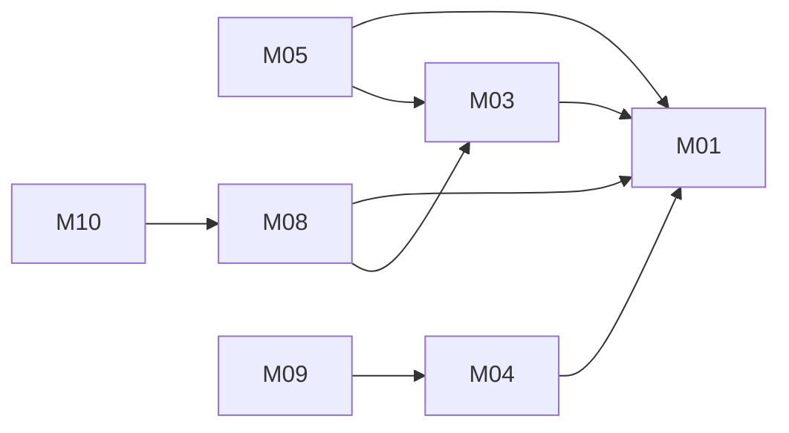

# Unified Community Forum: architecture

Version: 2026-11-04 · Status: approved (benchmark operator, pre-approved) · Structured copy: `architecture.json`

## Architecture style

| Style | Fit | Why |
| --- | --- | --- |
| modular monolith | good (selected) | one team, one release, post status and visibility change in one transaction, modest scale |
| microservices | poor | network and distributed data for three small modules sharing one table |
| service-oriented | poor | no existing system must stay separate |
| event-driven | partial | a "post published" event could feed notifications later; nothing kept is asynchronous now |
| hybrid | poor | no part needs a second style |

Selected: modular monolith, because of one team, strong consistency between
moderation and visibility, and no independent scaling need.

## Stack

| Layer | Choice | Why (decision id) |
| --- | --- | --- |
| Frontend | React 18 SPA built with Vite | both sources route screens client-side (D04) |
| Backend | Node.js 22 LTS, Express 4 | A is the user's own Express-style code; M05 adapts it (D02) |
| Database | PostgreSQL 16 | uuid, timestamptz, check constraints (D03) |
| Sessions | express-session + connect-pg-simple | cookie sessions (D05) |
| Passwords | argon2id | no source shows storage (D06) |
| Hosting | one container + managed PostgreSQL | no constraint given (user decides at deployment) |

## Modules

| Module | Responsibility | Features | Depends on | Owns entities |
| --- | --- | --- | --- | --- |
| platform | config, db, errors, validation, `can(user, action, post)` | - | - | - |
| accounts | users, passwords, sessions, roles | M01 | platform | User, Session |
| posts | create, read one, list published | M03, M04, M08, M09, M10 | platform, accounts | Post |
| moderation | queue and decisions | M05 | platform, accounts, posts | ModerationDecision |
| web | React screens | - | platform (via the API) | - |

### Feature dependency map

## Data model

| Entity | Merged from | Primary key | Key fields | Notes |
| --- | --- | --- | --- | --- |
| User | A:User, B:User | id uuid | email (unique, lower-case), display_name (A display_name, B name), role member/moderator, password_hash, legacy_id, imported_from, created_at | B ids kept in legacy_id |
| Session | new | sid text | sess json, expire timestamptz | index on expire |
| Post | A:Post, B:Post | id uuid | author_id → User (restrict), body 1..10000, status pending/published/rejected default pending, created_at timestamptz UTC, legacy_id, imported_from | null author only when imported_from = 'B'; index (status, created_at desc), index author_id |
| ModerationDecision | new | id uuid | post_id → Post (cascade, unique), moderator_id → User (restrict), decision published/rejected, decided_at | audit of each decision |

Full DDL: `schema.sql`. Migrations from source data: see `migration-plan.md`.
Re-keying B's users and posts to uuid is high risk (ids change, kept in
`legacy_id`); the plans are approved, running them is not.

## Authentication and authorization

One identity system: email and password (argon2id), server-side session in
an http-only, secure, SameSite=Lax cookie with a 7-day idle expiry, logout
destroys it. No bearer tokens. Roles member and moderator; moderating is the
permission `moderate-posts`. Every route and query asks
`platform.can(user, action, post)`:

- `read`: published → anyone; otherwise author or moderator (else 404)
- `create`: any signed-in user
- `moderate`: `moderate-posts`

| Source role | Unified role | Extra permissions |
| --- | --- | --- |
| A:member | member | - |
| A:moderator | moderator | moderate-posts |
| B:user | member | - |
| B:admin | member | none (B admin had no observed powers; promote by hand) |

## API

REST, versioned `/api/v1`, JSON, errors `{"error": {"code", "message"}}`,
cursor pagination (`?cursor=&limit=20`), one auth scheme (cookie session).
Detail in `api.md`.

| Method | Path | Module | Auth | Features |
| --- | --- | --- | --- | --- |
| POST | /api/v1/session | accounts | none | M01 |
| DELETE | /api/v1/session | accounts | session | M01 |
| GET | /api/v1/me | accounts | session | M01 |
| POST | /api/v1/posts | posts | session | M03, M04 |
| GET | /api/v1/posts/{id} | posts | public if published, else author/moderator | M08, M09 |
| GET | /api/v1/posts | posts | public | M10 |
| GET | /api/v1/moderation/queue | moderation | moderate-posts | M05 |
| POST | /api/v1/moderation/posts/{id}/decision | moderation | moderate-posts | M05 |

## Navigation

| Route | Screen | Module |
| --- | --- | --- |
| /login | Login | web |
| /posts | PostList (with compose form when signed in) | web |
| /posts/:id | PostDetail | web |
| /moderation | ModerationQueue (moderators only) | web |

## Design system

Tokens: colour roles bg, surface, text, muted, accent, danger, success (light
and dark, contrast AA); type scale 14/16/20/28; 4-px spacing base; radius 6.
Components: Button (primary, secondary, danger), TextField, TextArea with
10000-character counter, PostCard with status badge, Alert, Pagination.
System font stack; no icons needed. Nothing visual taken from either source.

## Configuration

| Variable | Purpose | Default |
| --- | --- | --- |
| DATABASE_URL | PostgreSQL connection (secret) | none |
| SESSION_SECRET | cookie signing (secret) | none; required |
| SESSION_TTL_HOURS | idle session expiry | 168 |
| COOKIE_SECURE | secure cookies | true (false only in local dev) |
| PORT | HTTP port | 3000 |

All read in `platform/config`; `.env.example` lists names only. Secrets never
in code or logs.

## Error handling

`{"error": {"code", "message"}}` with 400/401/403/404/409/422/500; 404 (not
403) for posts a user may not read, so existence is not revealed. Logs carry
request id, route, status and user id, never bodies, emails or passwords.
No external services, so no retries.

## Roadmap

| Slice | Features | Done when | Status |
| --- | --- | --- | --- |
| V1 | M01, M03, M04, M05, M08, M09 | AC01-AC09, AC11-AC15 pass, journey J1 (AC13) passes over HTTP | pending (plan mode: not built) |
| V2 | M10 | AC10 passes; AC13 re-run | pending (plan mode: not built) |

## Decisions

| Id | Decision | Reason | Approved |
| --- | --- | --- | --- |
| D01 | Modular monolith | one team, consistency, modest scale | yes (benchmark operator, pre-approved) |
| D02 | Node.js 22 + Express 4 | A's own stack; M05 adapted | yes |
| D03 | PostgreSQL 16 | A's types and constraints | yes |
| D04 | React 18 SPA (Vite) | client-side routing in both sources | yes |
| D05 | Cookie sessions in PostgreSQL; no JWT | compatibility decision | yes |
| D06 | argon2id | password storage unknown in both | yes |
| D07 | REST /api/v1, one error shape, cursor pagination | one API style | yes |
| D08 | Read rule only in platform can() | one place for authorisation | yes |
| D09 | Settings from environment variables | B hard-coded its key | yes |
| D10 | No code copied from B; A's moderation handlers adapted | B is Python | yes |
