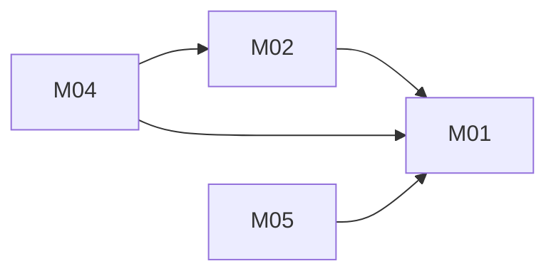

# Shelfie + Readr reading app: architecture

Version: 2026-11-04 · Status: approved (benchmark operator, pre-approved) · Structured copy: `architecture.json`

Basis: designed from what the sources' code does (observed). Shelfie's
README, docs/architecture.md and openapi.yaml are out of date and were not
used as design inputs where the code disagrees (A-C01..A-C08).

## Architecture style

| Style | Fit | Why |
| --- | --- | --- |
| modular monolith | good | one owner, one release, 4 features, cascades need one database |
| microservices | poor | Shelfie's docs describe catalog/ratings/gateway services, but the code never had them; no scaling need |
| service-oriented | poor | no existing system must stay separate |
| event-driven | poor | nothing asynchronous |
| hybrid | poor | no part needs a second style |

Selected: modular monolith, because one small app with strongly consistent data (book → rating, list entries) needs one process and one database (D03).

## Stack

| Layer | Choice | Why (decision id) |
| --- | --- | --- |
| Frontend | one static HTML page, vanilla JavaScript, no build | neither source has a UI; nothing to install (D02) |
| Backend | Python 3.10+ standard library (wsgiref, json, sqlite3, hashlib.scrypt, secrets) | both sources are stdlib Python; no installs approved (D01) |
| Database | SQLite, foreign keys on, WAL | both sources' code use SQLite (README's PostgreSQL claim is outdated) (D01, D08) |
| Hosting | single process; not decided | deployment out of scope |
| Tests | unittest, HTTP-level against a temp database | stdlib, recorded by run_tests.py |

## Modules

| Module | Responsibility | Features | Depends on | Owns entities |
| --- | --- | --- | --- | --- |
| core | config, DB connection (commit per request, FKs on), router, error format, can_access() | - | - | - |
| accounts | sign up/in/out, sessions, password hashing | - (platform) | core | User, Session |
| library | a person's books | M01 | core, accounts | Book |
| ratings | 1-5 stars, one per person per book | M02 | core, accounts, library | Rating |
| lists | reading lists and their books | M05 | core, accounts, library | ReadingList, ListBook |
| export | JSON export | M04 | core, accounts, library, ratings | - |
| web | static UI | - | core | - |

### Feature dependency map

## Data model

| Entity | Merged from | Primary key | Key fields | Notes |
| --- | --- | --- | --- | --- |
| User | new | id integer | email unique, password_hash | platform piece (D04) |
| Session | new | token_hash | user_id, expires_at | server-side |
| Book | A:Book, B:Book | id integer | owner_id, title (A, B), author (A, nullable) | same thing in both apps |
| Rating | A:Rating | (owner_id, book_id) | stars 1-5 CHECK | was appended in both; now one per person per book (D05) |
| ReadingList | B:ReadingList | id integer | owner_id, name required | |
| ListBook | B:ListBook | (list_id, book_id) | added_at | duplicates now impossible |

Full DDL: `schema.sql`. Deletes: Book → Rating, ListBook cascade; ReadingList → ListBook cascade; User → everything cascade.

Migrations from source data: none. The app starts with an empty database (D09). Importing shelfie.db/readr.db would re-key Readr's integer ids (high risk) and needs its own plan and approval; see `migration-plan.md`.

## Authentication and authorization

Identity: built-in accounts, email and password (scrypt). Session: random
token in an http-only, SameSite=Lax cookie (Secure behind HTTPS), stored
hashed server-side, 30-day expiry, deleted on sign out. One role, `member`,
who can only see and change rows they own; one function `can_access(person,
record)` used by every route; another person's ids answer 404.

Neither source has users, roles or auth (Shelfie's docs describe gateway
auth that its code does not have; its SHELFIE_SESSION_SECRET is unused and is
not carried over).

| Source role | Unified role | Extra permissions |
| --- | --- | --- |
| (none in A) | member | - |
| (none in B) | member | - |

## API

REST, JSON, under `/api` without a version prefix; one error shape
`{"error": {"code", "message"}}`; no pagination; session cookie on every
endpoint except sign up and sign in (D07). Full table with bodies and errors:
`api.md`.

| Method | Path | Module | Auth | Features |
| --- | --- | --- | --- | --- |
| POST | /api/signup | accounts | none | - |
| POST | /api/signin | accounts | none | - |
| POST | /api/signout | accounts | session | - |
| GET | /api/me | accounts | session | - |
| GET | /api/books | library | session | M01 (from A: GET /api/books) |
| POST | /api/books | library | session | M01 |
| GET | /api/books/export | export | session | M04 (from A: GET /api/books/export) |
| GET | /api/books/{id} | library | session | M01 |
| PATCH | /api/books/{id} | library | session | M01 |
| DELETE | /api/books/{id} | library | session | M01 |
| PUT | /api/books/{id}/rating | ratings | session | M02 (from A: PUT /api/books/{id}/rating) |
| DELETE | /api/books/{id}/rating | ratings | session | M02 |
| GET | /api/lists | lists | session | M05 |
| POST | /api/lists | lists | session | M05 |
| GET | /api/lists/{id} | lists | session | M05 |
| PATCH | /api/lists/{id} | lists | session | M05 |
| DELETE | /api/lists/{id} | lists | session | M05 |
| PUT | /api/lists/{id}/books/{book_id} | lists | session | M05 |
| DELETE | /api/lists/{id}/books/{book_id} | lists | session | M05 |

`/api/books/export` is matched before `/api/books/{id}`; ids are integers (D10).

## Navigation

| Route | Screen | Module |
| --- | --- | --- |
| /signin | Sign in / sign up | web |
| / | Library: books with stars, add book, export link | web |
| /books/{id} | Book: edit, rate, lists it is on | web |
| /lists | Reading lists | web |
| /lists/{id} | Reading list: books, add/remove | web |

## Design system

Tokens: colour roles bg, surface, text, muted, accent, danger, focus (light
and dark, contrast checked at build); type 14/16/20/28 px; spacing 4/8/16/24/32;
radius 6. System font stack, no downloaded fonts, no icon set (Unicode star).
Components: Button (primary, secondary, danger), TextField (with error),
StarRating (1-5, clearable, keyboard operable), BookRow, ListCard,
EmptyState, ErrorBanner. Nothing visual comes from either source (neither has a UI).

## Configuration

| Variable | Purpose | Default |
| --- | --- | --- |
| APP_DB_PATH | SQLite file | ./data/app.db |
| APP_HOST | bind address | 127.0.0.1 |
| APP_PORT | port | 8080 |
| SESSION_TTL_HOURS | session lifetime | 720 |
| COOKIE_SECURE | Secure cookie flag | false (dev), true behind HTTPS |

All read in `core/config.py`; `.env.example` lists names only. There are no
secrets to store (sessions are random tokens kept hashed in the database).
Shelfie's SHELFIE_DB and SHELFIE_SESSION_SECRET are not used.

## Error handling

Every error is `{"error": {"code", "message"}}` with 400/401/404/409; unknown
routes answer 404 (Shelfie sent nothing); malformed JSON answers 400 (Shelfie
dropped the connection). Logs record method, path, status and time only: no
emails, passwords, tokens or book titles. No external services, so no retries.

## Roadmap

| Slice | Features | Done when | Status |
| --- | --- | --- | --- |
| V1 | M01 (+ accounts, core, web shell) | AC01, AC02 (books), AC08, AC09 pass | pending |
| V2 | M02 | AC03, AC04 pass | pending |
| V3 | M05 | AC06, AC07, AC02 (lists) pass | pending |
| V4 | M04 | AC05, AC10 journey pass | pending |

## Decisions

| Id | Decision | Reason | Approved |
| --- | --- | --- | --- |
| D01 | Python stdlib + SQLite | both sources' code; no installs | yes (operator) |
| D02 | Static page + vanilla JS UI | no UI in either source; no build | yes (operator) |
| D03 | Modular monolith, one DB | documented services never existed | yes (operator) |
| D04 | Accounts + owner-only access | "people" keep libraries | yes (operator) |
| D05 | 1-5 stars, one per person per book | code of both apps | yes (operator) |
| D06 | JSON export, no CSV | Shelfie's code | yes (operator) |
| D07 | /api REST, one error shape, no paging | Shelfie's code paths | yes (operator) |
| D08 | Commit writes, FKs on, cascades | sources never commit | yes (operator) |
| D09 | Empty database, no import | no data provided | yes (operator) |
| D10 | export route before {id} | keep observed path | yes (operator) |
