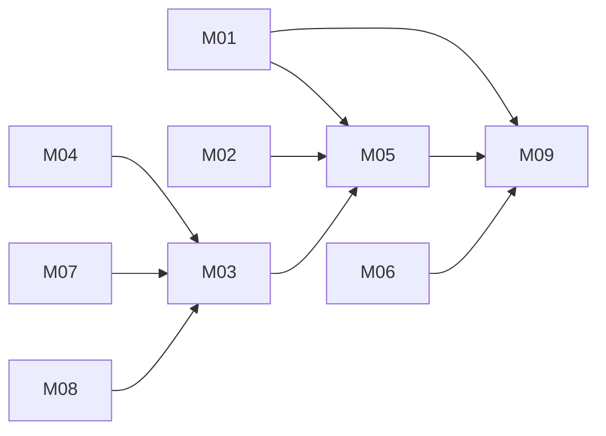

# Shared expenses with receipt scanning: architecture

Version: 2026-11-04 · Status: approved (benchmark operator, pre-approved) · Structured copy: `architecture.json`
Schema: `schema.sql` · API: `api.md` · Migrations: `migration-plan.md`

## Architecture style

| Style | Fit | Why |
| --- | --- | --- |
| modular monolith | good (selected) | one small team, strong consistency between budgets, membership and totals, modest load |
| microservices | poor | network calls and many deployables with no scaling or team need |
| service-oriented | poor | no existing system must stay separate |
| event-driven | partial | OCR could be asynchronous, but volume is low; a timed synchronous call with manual fallback is simpler |
| hybrid | partial | a queued OCR worker can be added later if scans get slow |

Selected: modular monolith, because one team, strong consistency and low volume; OCR, exchange rates and email
sit behind adapters with fakes so the app can be tested without those services.

## Stack

| Layer | Choice | Why (decision id) |
| --- | --- | --- |
| Frontend | Server-rendered Django templates, mobile-first, camera capture via file input | the user scans on a phone; no app store (D03) |
| Backend | Python 3.12, Django 5.x | Spendly is Python; built-in sessions, hashing, CSRF, ORM, migrations (D01) |
| Database | PostgreSQL 16; money as bigint minor units + currency | constraints for categories and amounts (D02) |
| Storage | Private S3-compatible bucket, 90-day retention | receipt photos are personal data (D04) |
| Hosting | Container host with managed PostgreSQL, user's choice | no deployment in this run (D09) |

## Modules

| Module | Responsibility | Features | Depends on | Owns entities |
| --- | --- | --- | --- | --- |
| accounts | sign-up, sign-in, sessions, users, home currency | platform | - | User |
| categories | Spendly's fixed list and validation | M09 | - | - |
| currency | exchange-rate adapter, minor-unit conversion | M02 | - | ExchangeRate |
| mailer | email adapter for invitations | platform | - | - |
| budgets | budgets, membership, invitations, removal, can_access | M03, M04, M07 | accounts, mailer | Budget, BudgetMember, Invitation |
| expenses | expenses, listing, edit, delete, monthly totals | M05, M06, M08 | accounts, budgets, categories, currency | Expense |
| receipts | upload, extraction adapter, review, confirm | M01 | accounts, budgets, expenses, categories, currency | ReceiptScan |

### Feature dependency map

## Data model

| Entity | Merged from | Primary key | Key fields | Notes |
| --- | --- | --- | --- | --- |
| User | A:User (inferred) | uuid | email, display_name, password_hash, home_currency | shared across budgets (D11) |
| Budget | A:Budget | uuid | name, limit_minor, currency, timezone, owner_id, is_personal | the tenant; personal budget per user |
| BudgetMember | A:BudgetMember | uuid | budget_id, user_id, role, removed_at | one active owner per budget |
| Invitation | new | uuid | budget_id, email, token_hash, expires_at, accepted_at | single use |
| Expense | A:Expense, B:Expense | uuid | budget_id, created_by, merchant, amount_minor, currency, budget_amount_minor, fx_rate, fx_rate_date, date, category, note, scan_id | category check (food, travel, home, other); amount > 0 |
| ReceiptScan | new | uuid | budget_id, uploaded_by, image_key, status, extracted fields, date_needs_confirmation, expense_id | |
| ExchangeRate | new | uuid | base, quote, rate_date, rate | shared reference data |

Field origins: `amount_minor` from A:Expense.amount (decimal major units) and B:Expense.amount_cents (integer
cents); `category` from B:Expense.category (Spendly's list; Tallyho's values unknown and dropped with M10);
`note` from B; `merchant`, `currency`, `date`, `budget_id` from A.

Migrations from source data: none. Spendly stores nothing; Tallyho data is not imported. The checker's high-risk
steps (decimal to minor units, unknown id types to uuid) apply only to a future import, which needs its own
approval (`migration-plan.md`).

## Authentication and authorization

One identity system: email and password (Django auth, slow hash). Server-side sessions in http-only, Secure,
SameSite=Lax cookies; CSRF on every form. Roles per budget: owner and member. One function,
`can_access(user, action, record)`, resolves the record's budget, requires an active membership
(`removed_at IS NULL`), then checks the role permission; every view and query uses it, and list queries filter by
the caller's active memberships. Non-members get 404.

| Source role | Unified role | Extra permissions |
| --- | --- | --- |
| A:owner | owner | edit budget, invite, remove members, edit/delete any expense |
| A:member | member | add expenses, edit/delete own expenses |
| B (no roles; single user) | owner of their personal budget | - |

## API

REST JSON under `/api/v1`; one error shape `{"error": {"code", "message"}}`; cursor pagination on expense lists;
session auth on every endpoint except sign-up and sign-in. Full list in `api.md` and `architecture.json`.

| Method | Path | Module | Auth | Features |
| --- | --- | --- | --- | --- |
| GET | /api/v1/budgets | budgets | session | M03 |
| POST | /api/v1/budgets | budgets | session | M03 |
| GET | /api/v1/budgets/{budget_id} | budgets | member | M03 |
| PATCH | /api/v1/budgets/{budget_id} | budgets | owner | M03 |
| POST | /api/v1/budgets/{budget_id}/invitations | budgets | owner | M04 |
| POST | /api/v1/invitations/{token}/accept | budgets | session, email match | M04 |
| DELETE | /api/v1/budgets/{budget_id}/members/{user_id} | budgets | owner | M07 |
| GET | /api/v1/budgets/{budget_id}/expenses | expenses | member | M05 |
| POST | /api/v1/budgets/{budget_id}/expenses | expenses | member | M05, M06, M02, M09 |
| PATCH | /api/v1/expenses/{expense_id} | expenses | adder or owner | M05 |
| DELETE | /api/v1/expenses/{expense_id} | expenses | adder or owner | M05 |
| GET | /api/v1/budgets/{budget_id}/summary | expenses | member | M08 |
| POST | /api/v1/budgets/{budget_id}/receipt-scans | receipts | member | M01 |
| GET | /api/v1/receipt-scans/{scan_id} | receipts | uploader | M01 |
| POST | /api/v1/receipt-scans/{scan_id}/confirm | receipts | uploader | M01, M09, M02 |
| GET | /api/v1/categories | categories | session | M09 |
| GET | /api/v1/fx/quote | currency | session | M02 |
| POST/GET | /api/v1/auth/*, /api/v1/me | accounts | none / session | platform |

## Navigation

| Route | Screen | Module |
| --- | --- | --- |
| /signup, /login | Sign up, Sign in | accounts |
| / | My budgets | budgets |
| /budgets/new | New budget | budgets |
| /budgets/{id} | Budget: spent vs limit, expenses | expenses |
| /budgets/{id}/members | Members and invitations | budgets |
| /budgets/{id}/expenses/new | Add expense | expenses |
| /expenses/{id}/edit | Edit expense | expenses |
| /budgets/{id}/scan | Scan receipt (camera) | receipts |
| /scans/{id}/review | Review scanned receipt | receipts |
| /invitations/{token} | Accept invitation | budgets |

## Design system

Own look; Tallyho's screenshots are reference only. Tokens: colour roles background, surface, text, muted,
primary, danger, warning (used for "needs confirmation" on the scanned date), success; 16 px base type with a
1.25 ratio; 4 px spacing grid; 8 px radius. System font stack; an open icon set (Lucide, ISC). Components: app
bar, budget card with progress bar, expense row, money input with currency select, category select, date input
with a needs-confirmation state, camera capture button, member list with owner badge, invite form, error banner,
empty states.

## Configuration

All settings are environment variables read in one config module; `.env.example` lists names only.
`DATABASE_URL`, `SECRET_KEY`, `ALLOWED_HOSTS`, `EMAIL_URL`, `DEFAULT_FROM_EMAIL`, `STORAGE_BUCKET`,
`STORAGE_ENDPOINT`, `STORAGE_ACCESS_KEY_ID`, `STORAGE_SECRET_ACCESS_KEY`, `RECEIPT_OCR_PROVIDER` (fake | provider),
`RECEIPT_OCR_API_KEY`, `RECEIPT_OCR_TIMEOUT_SECONDS` (15), `RECEIPT_IMAGE_RETENTION_DAYS` (90), `FX_PROVIDER`
(fake | provider), `FX_API_KEY`, `INVITATION_TTL_HOURS` (72), `SESSION_COOKIE_AGE` (14 days). Secrets live only
in the host's secret store, never in code or logs. The user creates the OCR, FX, email and storage accounts.

## Error handling

One error shape. OCR failure or timeout: 422 and the review screen opens empty for manual entry. FX failure:
the expense is refused with a clear message when its currency differs from the budget's (no silent rate);
cached rates for the same date are reused. Email failure: the invitation is kept and can be re-sent. Logs carry
request ids, never emails, amounts or images.

## Roadmap

| Slice | Features | Done when | Status |
| --- | --- | --- | --- |
| V1 | M05, M06, M09 | sign up, personal budget, add and list expenses; AC01, AC02, AC09, AC10 pass | pending |
| V2 | M01 | scan, review, confirm with fake extractor; AC03 passes | pending |
| V3 | M03, M04 | shared budget, invitation, isolation; AC05, AC06 pass | pending |
| V4 | M07 | removal; AC07 passes | pending |
| V5 | M08 | monthly summary; AC08 passes | pending |
| V6 | M02 | conversion with fake rates; AC04 passes | pending |

## Decisions

| Id | Decision | Reason | Approved |
| --- | --- | --- | --- |
| D01 | Python 3.12 + Django 5 | Spendly is Python; secure defaults built in | benchmark operator (pre-approved) |
| D02 | PostgreSQL; bigint minor units + currency | constraints; compatibility decision on amounts | benchmark operator (pre-approved) |
| D03 | Mobile-first server-rendered web with camera capture | the user scans on a phone | benchmark operator (pre-approved) |
| D04 | Private object storage for receipt images, 90-day retention | personal data | benchmark operator (pre-approved) |
| D05 | Modular monolith with OCR, FX, email adapters | drivers above; testable with fakes | benchmark operator (pre-approved) |
| D06 | Budget membership roles, personal budget, one can_access | compatibility decisions | benchmark operator (pre-approved) |
| D07 | Convert to budget currency, keep original, rate, rate date | compatibility decision | benchmark operator (pre-approved) |
| D08 | Scan review: all fields, date flagged, category required, no auto-save | user-reported wrong dates; Spendly rule | benchmark operator (pre-approved) |
| D09 | No deployment, no data migration | plan mode; no data to move | benchmark operator (pre-approved) |
| D10 | REST JSON /api/v1, one error shape, cursor pagination, session auth | one API style; M11 deferred | benchmark operator (pre-approved) |
| D11 | User shared across budgets; co-members see name and email only | a person belongs to several budgets | benchmark operator (pre-approved) |
