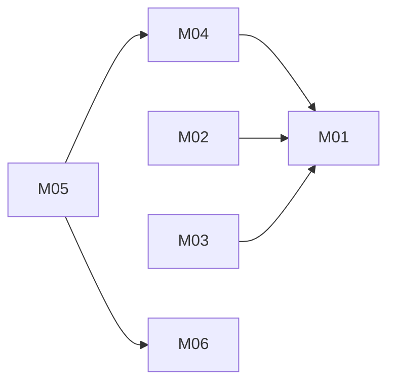

# Helpdesk with FAQ suggestions: architecture

Version: 2026-11-04 · Status: approved (pre-approved by the benchmark operator) · Structured copy: `architecture.json`

## Architecture style

| Style | Fit | Why |
| --- | --- | --- |
| modular monolith | good (selected) | one small team, strong consistency between tickets, replies and status, no scaling need |
| microservices | poor | a separate FAQ service adds network calls for one pure function |
| service-oriented | poor | no existing system must stay separate |
| event-driven | poor | suggestions are computed synchronously; nothing is asynchronous |
| hybrid | poor | no part needs another style |

Selected: modular monolith, because one team builds five small, tightly related features and no
packages may be installed, so one standard-library Python process is the simplest buildable shape.

## Stack

| Layer | Choice | Why (decision id) |
| --- | --- | --- |
| Frontend | server-rendered HTML forms, one CSS file | three screens of forms (D02) |
| Backend | Python 3.8+ standard library (wsgiref) | B is the user's Python; A cannot be reused; no installs (D01) |
| Database | SQLite, foreign keys on, check constraints | small scale; status rule enforced in the database (D03) |
| Hosting | not chosen | plan mode; no automatic deployment (D04) |

## Modules

| Module | Responsibility | Features | Depends on | Owns entities |
| --- | --- | --- | --- | --- |
| config | settings from environment variables | - | - | - |
| accounts | agents, sign-in, sessions, the permission check | platform | config | Agent, Session |
| faq | FAQ entries and the suggestion matcher | M06, M05 | config | FAQ |
| tickets | ticket lifecycle, replies, closing; asks faq for suggestions | M01, M04, M02, M03 | accounts, faq | Ticket, Message |
| web | routing, JSON API, HTML pages, error format | - | accounts, tickets, faq, config | - |

The suggestion matcher is a pure function `suggest(text, faqs, limit)` in `faq`; `tickets` passes it
the subject and description only (D08). It never reads replies.

### Feature dependency map

## Data model

| Entity | Merged from | Primary key | Key fields | Notes |
| --- | --- | --- | --- | --- |
| Agent | new | id integer | email (unique), name, password_hash | platform: no source has users |
| Session | new | token_hash text | agent_id → Agent (cascade), expires_at | only a hash of the token stored |
| Ticket | A:Ticket | id integer | subject, description, status (check open/pending/closed), created_by → Agent (restrict) | status from A:Ticket.status |
| Message | A:Message | id integer | ticket_id → Ticket (cascade), author_id → Agent (restrict), body | A's embedded list becomes rows |
| FAQ | B:FAQ | id integer | question (from q), answer (from a) | seeded with B's entry |

Full DDL: `schema.sql`. Times are UTC ISO 8601.

Migrations from source data: none will run. Neither source stores data (A keeps tickets in memory;
B's FAQ is hard-coded). The checker flags two high-risk mappings (A's embedded messages and the
text `from` field); their plan is approved in `compat/resolutions.json` and described in
`migration-plan.md`, and running any import needs its own approval.

## Authentication and authorization

One identity system: email and password agent accounts (PBKDF2-SHA256, per-agent salt), created by an
admin command (no public sign-up). Session: a random token in an http-only, SameSite=Lax cookie
(Secure in production); the database stores only its SHA-256; it expires after SESSION_TTL_MINUTES.
One role, `agent`, with permissions ticket:create, read, reply, set-status, close and faq:read. One
function `may(agent, action, record)` is called by every route. Single team, so there is no tenancy.

| Source role | Unified role | Extra permissions |
| --- | --- | --- |
| A: 'agent' (the literal author of replies) | agent | none |
| B: none (no users) | - | - |

## API

REST JSON under `/api/v1`, one error shape `{"error": {"code", "message"}}`, page/per_page
pagination, session cookie on every endpoint except sign-in. Details: `api.md`.

| Method | Path | Module | Auth | Features |
| --- | --- | --- | --- | --- |
| POST | /api/v1/session | accounts | none | platform |
| DELETE | /api/v1/session | accounts | session | platform |
| GET | /api/v1/tickets | tickets | session | M01 |
| POST | /api/v1/tickets | tickets | session | M04 |
| GET | /api/v1/tickets/{id} | tickets | session | M01, M05 |
| POST | /api/v1/tickets/{id}/status | tickets | session | M01 |
| POST | /api/v1/tickets/{id}/messages | tickets | session | M02 |
| POST | /api/v1/tickets/{id}/close | tickets | session | M03 |
| GET | /api/v1/tickets/{id}/suggestions | faq | session | M05 |
| GET | /api/v1/faqs | faq | session | M06 |

## Navigation

| Route | Screen | Module |
| --- | --- | --- |
| /login | Sign in | web |
| /tickets | Ticket list, filter by status | web |
| /tickets/new | New ticket | web |
| /tickets/{id} | Ticket: suggested answers, thread, reply, set status, close | web |

## Design system

Tokens in one CSS file: colour roles surface, text, muted, accent, danger (checked for WCAG AA
contrast); type scale 14/16/20/24 px; 4 px spacing grid; 6 px radius. System font stack; no icon set.
Components: button (primary, secondary, danger), text field, textarea, status badge (open, pending,
closed, with the word, not colour alone), suggestion card, message item, error banner. Nothing visual
comes from either source (neither has a UI).

## Configuration

| Variable | Purpose | Default |
| --- | --- | --- |
| HELPDESK_DB_PATH | SQLite file | ./helpdesk.db |
| HELPDESK_HOST | bind address | 127.0.0.1 |
| HELPDESK_PORT | port | 8000 |
| SESSION_TTL_MINUTES | session lifetime | 480 |
| FAQ_MAX_SUGGESTIONS | suggestions per ticket | 3 |
| HELPDESK_ENV | development or production | development |

All read in `config`; `.env.example` lists names only; `.env*` is git-ignored. No secrets are needed.
Nothing from A's `.env` (SMTP_PASSWORD, STRIPE_KEY) is carried over (D09).

## Error handling

Every error uses `{"error": {"code", "message"}}`: 401 unauthenticated, 404 missing record, 409 a
rule refused the change (closing a pending ticket: "answer the customer first"; replying to or
changing a closed ticket), 422 invalid input. Logs record method, path, status and duration, never
bodies, emails or tokens. There are no external services, so no retries.

## Roadmap

| Slice | Features | Done when | Status |
| --- | --- | --- | --- |
| V1 | M04, M01, M06, M05 | an agent signs in, creates a ticket and sees ranked FAQ suggestions; AC01, AC02, AC06-AC10 pass | pending |
| V2 | M02, M03 | reply and close with A's pending rule; AC03-AC05 and the J1 journey test (AC11) pass | pending |

Not built: plan mode.

## Decisions

| Id | Decision | Reason | Approved |
| --- | --- | --- | --- |
| D01 | Python 3 standard library backend | B is the user's Python; A not reusable; no installs | yes (benchmark operator) |
| D02 | Server-rendered HTML + JSON API /api/v1 | few screens | yes (benchmark operator) |
| D03 | SQLite with FKs and check constraints | small scale; enforce rules in the database | yes (benchmark operator) |
| D04 | No deployment target | plan mode; never automatic | yes (benchmark operator) |
| D05 | Modular monolith: config, accounts, faq, tickets, web | see style | yes (benchmark operator) |
| D06 | Agent accounts by admin command, one role | replies need an author; no source has users | yes (benchmark operator) |
| D07 | Agents may set open or pending; close is separate | A has pending but no way into it; open question | yes (benchmark operator) |
| D08 | Suggestions: subject + description, stop words and punctuation ignored, ranked, max 3 | compatibility decision and M05 improvement | yes (benchmark operator) |
| D09 | No email, no payments, no source env vars | contradicted docs; no feature; secret never copied | yes (benchmark operator) |
| D10 | One error format and pagination style | consistency | yes (benchmark operator) |
