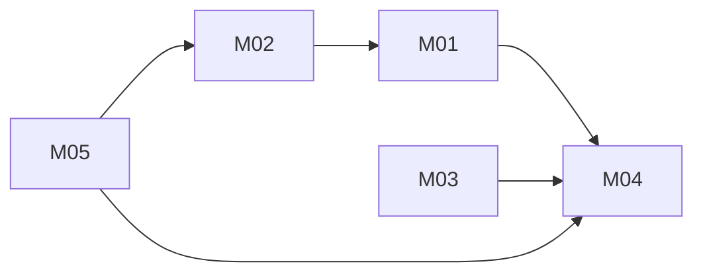

# Unified Identity: architecture

Version: 2026-11-05 · Status: approved (benchmark operator, pre-approved) · Structured copy: `architecture.json`

## Architecture style

| Style | Fit | Why |
| --- | --- | --- |
| modular monolith | good | one in-process library, strong consistency between users, identities, sessions and roles |
| microservices | poor | network calls and distributed data for a few hundred lines of logic |
| service-oriented | partial | the real OAuth provider is external; an adapter boundary is enough |
| event-driven | poor | nothing is asynchronous |
| hybrid | poor | no part needs a second style |

Selected: modular monolith, because it is the simplest design meeting every driver (D05).

## Stack

| Layer | Choice | Why (decision id) |
| --- | --- | --- |
| Frontend | none | the request is an identity module (D03) |
| Backend | Python 3.8+ standard library | task.md constraint (D01) |
| Database | in-memory store in the app object | matches sources and interface (D02) |
| Hosting | none (library) | no deployment requested |

## Modules

| Module | Responsibility | Features | Depends on | Owns entities |
| --- | --- | --- | --- | --- |
| roles (`unified/roles.py`) | role set, permissions, `can`, ranks, source-role mapping | M04 | - | Role |
| identity (`unified/identity.py`) | users, password credentials, federated identities and linking, sessions, admin-only role changes | M01, M02, M03, M05 | roles | User, PasswordCredential, Identity, Session |

### Feature dependency map

## Data model

| Entity | Merged from | Primary key | Key fields | Notes |
| --- | --- | --- | --- | --- |
| User | A:User, B:Account | id (text uuid4 hex) | email (normalised, optional), role | one account per person |
| PasswordCredential | A:User | email (unique) | user_id, salt, hash, iterations | owning a credential owns the email |
| Identity | B:Account | (provider, subject) | user_id, email, email_verified | a verified identity that created its user also owns its email |
| Session | A:Session | token_hash | user_id, expires_at | token never stored in clear |
| Role | C:Role | name | permissions | viewer, editor, admin |

Migrations from source data: none will run. The sources hold data only in process memory, so there is nothing
persisted to move (`migration-plan.md`).

## Authentication and authorization

One identity system with two sign-in methods: password (PBKDF2-HMAC-SHA256, random 16-byte salt, iteration count
stored per credential, constant-time compare) and federated OAuth (the provider's callback data). Both issue the same
session: an opaque `secrets.token_urlsafe(32)` token, stored as its SHA-256, expiring after 8 hours by default and
revoked by `logout`. Every failure to authenticate raises `AuthError` (a `ValueError`).

Linking (user decision, D06): `login_oauth` first finds the identity by (provider, subject). If new, and
`email_verified is True` and the normalised email is owned by an existing user, the identity joins that user;
otherwise a new user (role viewer) is created, and only a verified email is claimed as owned. An unverified email
never links and never claims.

Authorization: one role-based model from C; `can(role, permission)` is the one check. `set_role` resolves the caller
from the session, requires `manage_roles` (admin), validates the role and the target, and refuses any raise of the
caller's own role (D07, D10). `bootstrap_admin` creates the first admin only while no admin exists (D11).

| Source role | Unified role | Extra permissions |
| --- | --- | --- |
| A:user | editor | - |
| B:member | viewer | - |
| C:viewer | viewer | - |
| C:editor | editor | - |
| C:admin | admin | manage_roles (already in admin) |

## API

No HTTP API (D03). The Python interface required by task.md is the API; errors are exceptions.

| Call | Module | Auth | Features |
| --- | --- | --- | --- |
| `create_app(session_ttl=None, pbkdf2_iterations=None, clock=None)` | identity | - | platform |
| `register_password(email, password) -> user_id` | identity | none | M01 |
| `login_password(email, password) -> token` | identity | none; AuthError on failure | M02 |
| `login_oauth(provider, subject, email, email_verified) -> token` | identity | provider callback | M03 |
| `whoami(token) -> {user_id, email, role}` | identity | session; AuthError if invalid | M02, M03 |
| `logout(token)` | identity | session (idempotent) | M02 |
| `set_role(token, user_id, role)` | identity | session, admin | M05 |
| `map_source_role(source_app, role) -> role` | roles (re-exported) | none; KeyError if unknown | M04 |
| `bootstrap_admin(email, password) -> user_id` | identity | setup only, while no admin exists | M05 |

## Navigation

No screens in scope.

## Design system

No user interface in scope; no tokens or components.

## Configuration

| Variable | Purpose | Default |
| --- | --- | --- |
| `IDENTITY_SESSION_TTL_SECONDS` | session lifetime | 28800 |
| `IDENTITY_PBKDF2_ITERATIONS` | PBKDF2 iterations for new passwords | 100000 |

Arguments to `create_app` override the variables. No secrets exist in this module; a real OAuth client id and secret
would live in the provider adapter's environment, never in code.

## Error handling

`AuthError` (subclass of `ValueError`) for authentication failures and invalid sign-up input; `PermissionError` for
role changes by non-admins (including invalid sessions), self-raise, and a second bootstrap; `KeyError` for unknown
source roles and unknown target users; `ValueError` for unknown unified roles. Nothing logs emails, passwords or
tokens.

## Roadmap

| Slice | Features | Done when | Status |
| --- | --- | --- | --- |
| V1 | M04, M01, M02 | register, log in, whoami, logout, mapping tests pass | pending |
| V2 | M03 | OAuth linking tests pass | pending |
| V3 | M05 | role-change and bootstrap tests and the journey test pass | pending |

## Decisions

| Id | Decision | Reason | Approved |
| --- | --- | --- | --- |
| D01 | Python standard library only | task.md | yes |
| D02 | In-memory store in the app object | matches sources and interface | yes |
| D03 | No UI or HTTP; the Python interface is the API | hidden tests use it | yes |
| D04 | unittest suite | no installs approved | yes |
| D05 | Modular monolith, roles <- identity | simplest fit | yes |
| D06 | Link federated sign-in only on provider-verified email | user decision | yes |
| D07 | A user->editor, B member->viewer, C unchanged; admin-only changes; no self-raise | user decision | yes |
| D08 | Refuse duplicate registration | A's overwrite is a takeover | yes |
| D09 | AuthError subclasses ValueError | compatibility with A's callers | yes |
| D10 | set_role errors: PermissionError / ValueError / KeyError | task.md interface | yes |
| D11 | bootstrap_admin only while no admin exists | setup only | yes |
