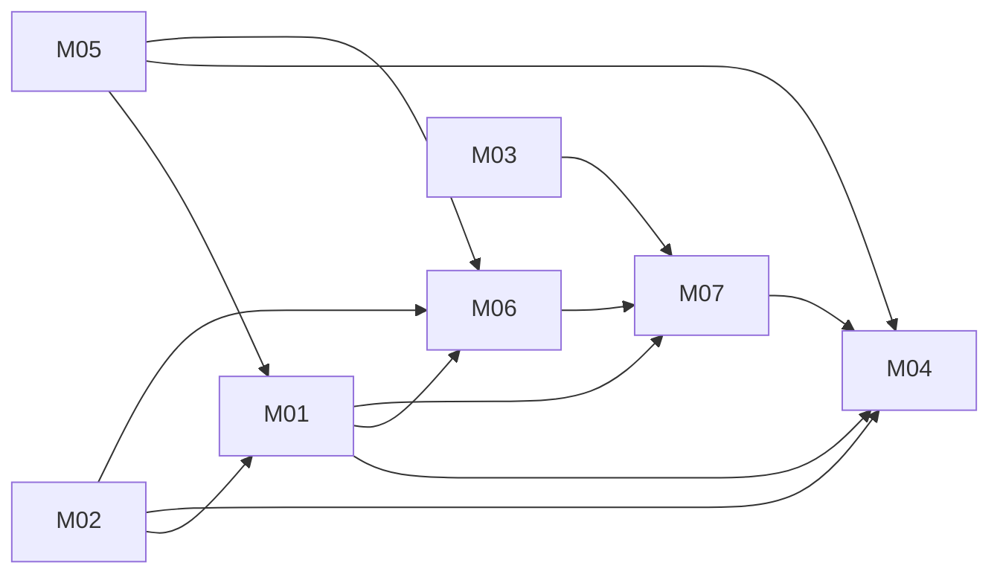

# Unified Billing: architecture

Version: 2026-11-05 · Status: approved (benchmark operator, pre-approved) · Structured copy: `architecture.json`

## Architecture style

| Style | Fit | Why |
| --- | --- | --- |
| modular monolith | good (selected) | one in-process library; an order, its ledger entry and its webhook id must change together |
| microservices | poor | every state change would become a distributed transaction |
| service-oriented | poor | no existing system that must stay separate; the gateway is already behind an adapter |
| event-driven | partial | webhooks are events, but synchronous handling with event-id dedupe is enough |
| hybrid | poor | no part has different needs |

Selected: modular monolith, because the drivers are strong consistency,
exactly-once money movement, one small library and no scaling need.

## Stack

| Layer | Choice | Why (decision id) |
| --- | --- | --- |
| Frontend | none | the interface is the Python API in task.md (D09) |
| Backend | Python 3.8+ standard library, one module `app/unified/billing.py` | D01, D02 |
| Database | `MemoryStore` with atomic batch writes; any store passed to `create_app` contributes its `fail_next_write` flag | D04 |
| Hosting | in-process in the host app; nothing deployed | D09 |
| Tests | unittest | D01 |

## Modules

All modules are sections of `app/unified/billing.py` (D02), each depending
only on the ones listed.

| Module | Responsibility | Features | Depends on | Owns entities |
| --- | --- | --- | --- | --- |
| store | atomic batch writes; StoreError; fail_next_write | - | - | - |
| gateway-adapter | charge / refund calls; timeout recognition | - | - | - |
| orders | create, read, transition table | M04, M07 | store | Order |
| ledger | charge and refund entries | M06 | store, orders | LedgerEntry |
| payments | pay(): key binding, attempt key, timeout retry | M01 | orders, ledger, gateway-adapter, store | IdempotencyKey |
| refunds | cancel(): cancel or refund once | M05 | orders, ledger, gateway-adapter, store | - |
| webhooks | handle_webhook(): dedupe, by type | M02 | orders, ledger, refunds, store | WebhookEvent |
| subscriptions | renew(): one order per period | M03 | orders, store | Renewal |
| facade | create_app, BillingApp, one lock | - | all of the above | - |

### Feature dependency map

## Data model

| Entity | Merged from | Primary key | Key fields | Notes |
| --- | --- | --- | --- | --- |
| Order | A:Order, C:Order | id text `ord_<n>` | customer, amount_cents (int > 0), status (pending, paid, cancelled, refunded), charge_id, attempt_key, refund_state, refund_id | A's `paid` becomes `status == 'paid'` (D03) |
| LedgerEntry | new | list position | order_id, kind (charge, refund), amount_cents | append-only |
| IdempotencyKey | new | key | order_id | one key, one order |
| WebhookEvent | new | event id | - | written with the event's effect |
| Renewal | B:Subscription | (subscription_id, period) | order_id, customer, price_cents | one order per period |

Status transitions: pending → paid, pending → cancelled, paid → refunded,
cancelled → refunded (a late charge refunded at once). Anything else is
refused with `InvalidTransition`.

Migrations from source data: none run. The sources hold orders only as
in-memory dicts, so there is no data to move. The mapping, if data ever
existed: A `amount` → `amount_cents` (unit to be confirmed), A `paid=True`
→ `status='paid'`, C `status` kept. Risk low (fields added); no
destructive step.

## Authentication and authorization

None in any source and none in the unified module: it is a library called
in-process, and the host authenticates its callers and decides who may
cancel. No roles, so no role mapping.

| Source role | Unified role | Extra permissions |
| --- | --- | --- |
| (none in any source) | - | - |

## API

Python object API from task.md; no HTTP, so no endpoints, versioning or
pagination. Errors are exceptions, all subclasses of `BillingError`:
`InvalidRequest` (also `ValueError`), `UnknownOrder` (also `KeyError`),
`InvalidTransition`, `IdempotencyConflict`, `RefundPending`, `StoreError`.
Gateway errors other than a recovered timeout propagate unchanged.

| Call | Module | Features |
| --- | --- | --- |
| `create_app(gateway, store=None)` | facade | - |
| `create_order(customer, amount_cents) -> order_id` | orders | M07 |
| `order(order_id) -> {status, amount_cents, charge_id}` | orders | M07, M04 |
| `pay(order_id, key) -> charge_id` | payments | M01 |
| `handle_webhook(event)` | webhooks | M02 |
| `cancel(order_id)` | refunds | M05 |
| `ledger() -> [{order_id, kind, amount_cents}]` | ledger | M06 |
| `renew(subscription, period) -> order_id` | subscriptions | M03 |

## Navigation

None (no user interface).

## Design system

None (no user interface).

## Configuration

No environment variables or secrets. The gateway and the store are passed to
`create_app`.

## Error handling

- One atomic write per state change; a failed write raises `StoreError` and
  changes nothing (D04).
- Intent before gateway calls (D05): the attempt key for pay, the refund
  intent for cancel.
- Gateway timeout: one retry with the same key, which is safe because the
  gateway is idempotent by key (D06).
- A refund with an unknown outcome is never re-sent (D08).
- No logging of customer data.

## Roadmap

| Slice | Features | Done when | Status |
| --- | --- | --- | --- |
| V1 | M07, M04, M01, M06 | create, pay once, ledger; AC01, AC02, AC04 (pay), AC06, AC08, AC09 pass | pending |
| V2 | M02 | AC03 and webhook part of AC04 pass | pending |
| V3 | M05 | AC05, cancel part of AC04, journey AC10 pass | pending |
| V4 | M03 | AC07 passes | pending |

## Decisions

| Id | Decision | Reason | Approved |
| --- | --- | --- | --- |
| D01 | Python standard library only; unittest | Python module asked for; no installs approved | yes (benchmark operator) |
| D02 | Modular monolith in one file with a section per module | fixed module path; imports the same way however it is loaded | yes (benchmark operator) |
| D03 | One status field with a transition table | order-payment-state resolution | yes (benchmark operator) |
| D04 | Atomic batch writes; fail_next_write honoured on the store passed in | write-failure resolution; task.md store contract | yes (benchmark operator) |
| D05 | Intent written before every gateway call | no money movement without a record | yes (benchmark operator) |
| D06 | Timeout recognised by class name, retried once with the same key | gateway-timeout resolution | yes (benchmark operator) |
| D07 | Cancel of a paid order ends `refunded`; a late charge on a cancelled order is refunded | cancel-paid-order resolution | yes (benchmark operator) |
| D08 | A refund with an unknown outcome is never re-sent automatically | the gateway's refund is not idempotent | yes (benchmark operator) |
| D09 | No HTTP, auth or UI layer | the API in task.md is the interface | yes (benchmark operator) |
