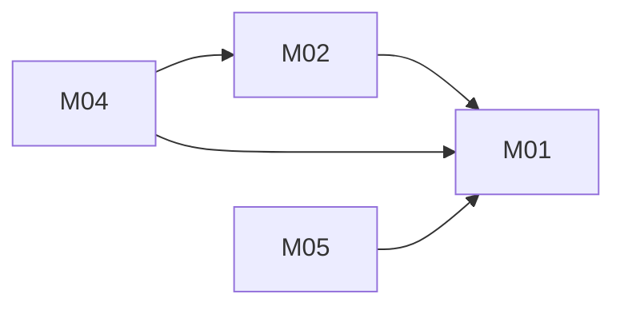

# Shelfie + Readr unified reading app: architecture

Version: 2026-11-04 · Status: approved (benchmark operator, pre-approved) · Structured copy: `architecture.json`

Designed from what the source code does. Shelfie's docs (three services, PostgreSQL, CSV export, 1-10 ratings,
/api/v1 paths) contradict its code and were not used as requirements (D01; conflicts in `compat/`).

## Architecture style

| Style | Fit | Why |
| --- | --- | --- |
| modular monolith | good (selected) | one owner, one release cadence, six entities that must stay consistent, no scaling need |
| microservices | poor | Shelfie's docs describe catalog/ratings/gateway services, but the code never had them and nothing here needs separate deployment |
| service-oriented | poor | no external system to keep separate |
| event-driven | poor | every action is synchronous with an immediate result |
| hybrid | poor | no part needs a second style |

Selected: modular monolith, because it is the simplest design that meets every driver (D04).

## Stack

| Layer | Choice | Why (decision id) |
| --- | --- | --- |
| Frontend | server-rendered HTML + small vanilla JS, no build | D10 |
| Backend | Python 3.10+ standard library: WSGI, sqlite3, hashlib.scrypt | D02 |
| Database | SQLite, WAL, foreign keys on (`schema.sql`) | D03 |
| Hosting | any Python WSGI host; wsgiref in development; nothing deploys without approval | D02 |
| Tests | unittest (standard library) | D02 |

## Modules

| Module | Responsibility | Features | Depends on | Owns entities |
| --- | --- | --- | --- | --- |
| config | env vars with dev defaults | - | - | - |
| accounts | sign up/in/out, sessions, scrypt, `can()` ownership check | - | config | User, Session |
| library | CRUD of own books | M01 | accounts | Book |
| ratings | one 1-5 rating per user per book | M02 | library, accounts | Rating |
| reading-lists | lists and their books | M05 | library, accounts | ReadingList, ReadingListItem |
| export | JSON download of own library | M04 | library, ratings, accounts | - |
| web | routing, cookies, CSRF, error shape, layout | - | all of the above | - |

### Feature dependency map

## Data model

| Entity | Merged from | Primary key | Key fields | Notes |
| --- | --- | --- | --- | --- |
| User | new | id integer | email (unique, case-insensitive), password_hash | no source had users |
| Session | new | id text (hash of token) | user_id → User (cascade), expires_at | |
| Book | A:Book, B:Book | id integer | owner_id → User, title (1-300), author (A only, nullable) | index (owner_id, title) |
| Rating | A:Rating | id integer | user_id, book_id → Book (cascade), stars CHECK 1-5 integer; unique (user_id, book_id) | was append-only, no key |
| ReadingList | B:List | id integer | owner_id, name (1-100, unique per owner) | renamed from List |
| ReadingListItem | B:ListBook | (list_id, book_id) | both cascade | renamed; duplicates impossible |

Migrations from source data: none in this plan (D11). An import would be high risk (book id collisions, ratings
collapsing to one per book) and needs its own approval; see `migration-plan.md`.

## Authentication and authorization

Email and password; scrypt (n=2^14, r=8, p=1, 16-byte salt). Server-side sessions: a 32-byte random token in an
http-only, SameSite=Lax cookie (Secure in production), stored only as its SHA-256; 14-day expiry; sign-out deletes
it. CSRF: double-submit token on every state-changing request. One role, `reader`; `accounts.can(user, action,
record)` checks ownership and is called by every handler and every query filters on owner. Another user's record
returns 404. Login failures return the same message for unknown email and wrong password.

| Source role | Unified role | Extra permissions |
| --- | --- | --- |
| A: none (all routes open; `SHELFIE_SESSION_SECRET` unused) | reader | none |
| B: none (no interface) | reader | none |

## API

REST JSON under `/api/v1` (D07); error shape `{"error": {"code", "message"}}`; limit/offset paging; session cookie
auth on everything except signup and login. Full detail in `api.md`.

| Method | Path | Module | Auth | Features |
| --- | --- | --- | --- | --- |
| POST | /api/v1/auth/signup | accounts | none | - |
| POST | /api/v1/auth/login | accounts | none | - |
| POST | /api/v1/auth/logout | accounts | session | - |
| GET | /api/v1/auth/me | accounts | session | - |
| GET | /api/v1/books | library | session | M01 |
| POST | /api/v1/books | library | session | M01 |
| GET | /api/v1/books/{id} | library | session | M01 |
| PATCH | /api/v1/books/{id} | library | session | M01 |
| DELETE | /api/v1/books/{id} | library | session | M01 |
| PUT | /api/v1/books/{id}/rating | ratings | session | M02 |
| DELETE | /api/v1/books/{id}/rating | ratings | session | M02 |
| GET | /api/v1/export | export | session | M04 |
| GET | /api/v1/lists | reading-lists | session | M05 |
| POST | /api/v1/lists | reading-lists | session | M05 |
| GET | /api/v1/lists/{id} | reading-lists | session | M05 |
| PATCH | /api/v1/lists/{id} | reading-lists | session | M05 |
| DELETE | /api/v1/lists/{id} | reading-lists | session | M05 |
| PUT | /api/v1/lists/{id}/books/{book_id} | reading-lists | session | M05 |
| DELETE | /api/v1/lists/{id}/books/{book_id} | reading-lists | session | M05 |

## Navigation

| Route | Screen | Module |
| --- | --- | --- |
| /signup | Sign up | accounts |
| /login | Sign in | accounts |
| /library | My library (books with star ratings, add form) | library |
| /books/{id} | Book detail (edit, rate, add to list) | library |
| /lists | My reading lists | reading-lists |
| /lists/{id} | Reading list detail | reading-lists |

`/` redirects to `/library` (signed in) or `/login`. Export is a download link in the library header.

## Design system

Tokens: bg `#fbfaf7`, surface `#ffffff`, text `#1f2328`, muted `#5b636e`, accent `#2f5d8a`, star `#b7791f`, danger
`#b42318` (all AA on bg); 16px base with 1.25 type scale; 4px spacing grid; 6px radius. System font stack, Unicode
stars, no licensed fonts or icon sets, nothing visual taken from the sources (they have no UI). Components: page
shell with nav, book row, star rating radio group, form field with error, buttons (primary, secondary, danger),
empty state, flash message.

## Configuration

| Variable | Purpose | Default |
| --- | --- | --- |
| APP_ENV | development or production | development |
| DATABASE_PATH | SQLite file | ./data/app.db |
| SESSION_SECRET | signs session/CSRF cookies; required in production (replaces Shelfie's undocumented, unused SHELFIE_SESSION_SECRET) | random per process in development |
| SESSION_TTL_DAYS | session lifetime | 14 |
| HOST / PORT | bind address | 127.0.0.1 / 8000 |

All read in `config`; `.env.example` lists names only; secrets never in code or logs.

## Error handling

Every error uses the JSON shape above (HTML pages show the message inline). Unknown routes return 404 (Shelfie
sent nothing); malformed JSON or non-integer ids return 400 (Shelfie crashed); unexpected errors return 500 with
a generic message and a request id, logged without personal data. Every write is one committed transaction. No
external services, so no retries.

## Roadmap

| Slice | Features | Done when | Status |
| --- | --- | --- | --- |
| V1 | M01, M02 (+ accounts) | AC01-AC05, AC10 pass | pending |
| V2 | M05 | AC07-AC09 pass | pending |
| V3 | M04 | AC06 passes | pending |

Not built in plan mode.

## Decisions

| Id | Decision | Reason | Approved |
| --- | --- | --- | --- |
| D01 | Code over Shelfie's docs where they disagree | user instruction | yes |
| D02 | Python standard library only | sources are stdlib; installs not approved | yes |
| D03 | SQLite, WAL, foreign keys on | what both apps use; PostgreSQL claim stale | yes |
| D04 | Modular monolith | see style | yes |
| D05 | Email/password, scrypt, server-side cookie sessions | no source had auth | yes |
| D06 | One role, ownership via one `can()` | personal data only | yes |
| D07 | REST /api/v1, one error shape, limit/offset | one style | yes |
| D08 | Ratings 1-5, one per user per book, upsert | both codebases use 1-5; append was a bug | yes |
| D09 | JSON export, one row per book; no CSV | code exports JSON; CSV only in stale docs | yes |
| D10 | Server-rendered HTML, small JS | no toolchain to install | yes |
| D11 | No source data import | data existence unknown; import is high risk | yes |
| D12 | Rebuild everything, copy nothing | sources small and carry the bugs being fixed | yes |

Approved by: benchmark operator (pre-approved), 2026-11-04.
