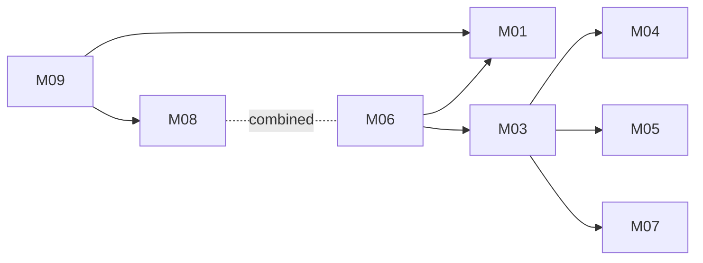

# Unified expense app: architecture

Version: 2026-11-04 · Status: approved (benchmark operator, pre-approved) · Structured copy: `architecture.json`

## Architecture style

| Style | Fit | Why |
| --- | --- | --- |
| modular monolith | good (selected) | One small team, one release cadence, strong consistency between expenses, membership and totals, household-scale load |
| microservices | poor | Network calls and distributed data for a few small modules; no team or scaling reason |
| service-oriented | poor | No existing system to keep separate; OCR is an adapter to a provider |
| event-driven | partial | OCR and invitation email are asynchronous, but volume is low; synchronous with timeout and fallback is enough |
| hybrid | partial | Monolith + background OCR job, if scans prove slow (revisit under D04) |

Selected: modular monolith, because one team, strong consistency and low
volume; the one permission function stays in one process.

## Stack

| Layer | Choice | Why (decision id) |
| --- | --- | --- |
| Frontend | Server-rendered mobile-first pages (Django templates), a little plain JS; camera via file input | User scans on a phone; one codebase (D03) |
| Backend | Python 3.12, Django 5.2 LTS | Spendly is Python (adapt categories); built-in auth, sessions, CSRF, migrations, email (D01) |
| Database | PostgreSQL 16 | Constraints, monthly sums, managed everywhere (D02) |
| Storage | S3-compatible private bucket | Receipt images are personal data (D13) |
| OCR | ReceiptReader adapter; provider chosen by the user before V3; fake in dev and tests | Tallyho's engine is closed; needs the user's keys (D07) |
| Email | Django email backend; console in dev, locmem in tests | Invitations (D08) |
| Hosting | Managed platform + managed PostgreSQL, chosen by the user | Not part of this plan; no automatic deployment |

## Modules

| Module | Responsibility | Features | Depends on | Owns entities |
| --- | --- | --- | --- | --- |
| accounts | Sign-up, sign-in, email verification, sessions (platform) | - | - | User |
| mailer | Transactional email (platform) | - | - | - |
| categories | Spendly's four categories and validation | M09 | - | - |
| budgets | Budgets, membership, the one permission function | M03 | accounts | Budget, Membership |
| members | Invitations and owner removal | M04, M05 | budgets, accounts, mailer | Invitation |
| expenses | Expense CRUD and validation | M06, M08 | accounts, budgets, categories | Expense |
| budget-period | Monthly spent of limit; budget overview | M07 | budgets, expenses | - |
| receipts | Upload, private storage, OCR adapter, review draft, confirm into expense | M01 | accounts, budgets, categories, expenses | Receipt |

### Feature dependency map

## Data model

| Entity | Merged from | Primary key | Key fields | Notes |
| --- | --- | --- | --- | --- |
| User | A:User | uuid | email (citext, unique), password_hash, email_verified_at | Spendly has no users |
| Budget | A:Budget | uuid | name, limit_minor, currency, time_zone, owner_id | one owner |
| Membership | A:BudgetMember | uuid | budget_id, user_id, role (owner, member), removed_at | soft removal keeps former-member attribution (D06) |
| Invitation | new | uuid | budget_id, email, token_hash, expires_at, accepted_at | single use, 7 days (D14) |
| Expense | A:Expense, B:Expense | uuid | author_id, budget_id (nullable), amount_minor (A amount, B amount_cents), currency, spent_on (A date), merchant, category (B list), note (B), receipt_id | budget expenses match budget currency (D05) |
| Receipt | new | uuid | uploaded_by, storage_key, status, extracted_*, date_flagged | private image (D13) |

Full DDL in `schema.sql`. Migrations from source data: none. Spendly
persists nothing; no Tallyho data is imported. The compatibility report's
high-risk rows describe a hypothetical import from Tallyho's undocumented
types; the approved plan is that none runs (`migration-plan.md`).

## Authentication and authorization

One identity system: email and password (Django auth, slow hash), email
verification, server-side sessions in an http-only, secure, SameSite=Lax
cookie, CSRF on writes. Tallyho's personal access tokens are not carried
over (public API deferred, M11).

Roles per budget: owner, member. One function, `can(user, action, obj)`,
in the budgets module, answers every check; every query is scoped through
it. Current membership means `removed_at is null`.

| Source role | Unified role | Extra permissions |
| --- | --- | --- |
| A: owner | budget-owner | edit budget, invite, remove members, delete any budget expense |
| A: member | budget-member | view budget and all its expenses, add expenses, edit and delete own |
| B: none (no users) | user | author of personal expenses (only they see them) |
| A: removed member (user's notes) | none | no access; expenses stay, shown as former member |

## API

REST JSON under `/api/v1`, one error shape `{"error": {"code", "message",
"fields"}}`, cursor pagination, session auth everywhere except sign-up,
sign-in and verification (D16). Full contracts in `api.md`.

| Method | Path | Module | Auth | Features |
| --- | --- | --- | --- | --- |
| POST | /api/v1/auth/signup | accounts | none | - |
| POST | /api/v1/auth/login | accounts | none | - |
| POST | /api/v1/auth/logout | accounts | session | - |
| POST | /api/v1/auth/verify-email | accounts | signed token | - |
| GET | /api/v1/me | accounts | session | - |
| GET | /api/v1/categories | categories | session | M09 |
| POST | /api/v1/budgets | budgets | session | M03 |
| GET | /api/v1/budgets | budgets | session | M03 |
| GET | /api/v1/budgets/{budget_id} | budgets | member | M03 |
| PATCH | /api/v1/budgets/{budget_id} | budgets | owner | M03 |
| GET | /api/v1/budgets/{budget_id}/summary | budget-period | member | M07, M03 |
| GET | /api/v1/budgets/{budget_id}/members | members | member | M03, M05 |
| POST | /api/v1/budgets/{budget_id}/invitations | members | owner | M04 |
| POST | /api/v1/invitations/{token}/accept | members | verified matching email | M04 |
| DELETE | /api/v1/budgets/{budget_id}/members/{user_id} | members | owner | M05 |
| POST | /api/v1/expenses | expenses | session | M06, M08, M09 |
| GET | /api/v1/expenses | expenses | session | M06 |
| GET | /api/v1/expenses/{expense_id} | expenses | author or member | M06 |
| PATCH | /api/v1/expenses/{expense_id} | expenses | author (current member) | M06, M08 |
| DELETE | /api/v1/expenses/{expense_id} | expenses | author or owner | M06 |
| POST | /api/v1/receipts | receipts | session | M01 |
| GET | /api/v1/receipts/{receipt_id} | receipts | uploader | M01 |
| GET | /api/v1/receipts/{receipt_id}/image | receipts | uploader or expense access | M01 |
| POST | /api/v1/receipts/{receipt_id}/expense | receipts | uploader | M01, M06, M09 |

## Navigation

| Route | Screen | Module |
| --- | --- | --- |
| /signup | Sign up | accounts |
| /login | Sign in | accounts |
| / | My expenses and budgets | expenses |
| /expenses/new | Add expense | expenses |
| /expenses/{expense_id} | Expense detail and edit | expenses |
| /budgets/new | Create budget | budgets |
| /budgets/{budget_id} | Budget overview (spent of limit this month) | budget-period |
| /budgets/{budget_id}/members | Members, invite, remove | members |
| /invitations/{token} | Accept invitation | members |
| /scan | Scan a receipt | receipts |
| /scan/{receipt_id} | Review scanned receipt | receipts |

## Design system

The user's own tokens: colour roles background, surface, text, muted,
primary, danger, warning (the "check this date" flag), success; type scale
14/16/20/24/32 px; 4 px spacing base; radius 4, 8, pill. Font Inter (OFL),
icons Lucide (ISC). Components: button (primary, secondary, danger), text
field (default, error, flagged), money field, category picker (four
options, no default), date field (default, flagged), budget progress bar
(under, near, over), member row (owner, member, former member),
confirmation dialog, empty state, error banner. Nothing visual, textual or
iconic is taken from Tallyho's screenshots.

## Configuration

One settings module reads environment variables; `.env.example` lists the
names only. Secrets: DATABASE_URL, DJANGO_SECRET_KEY, EMAIL_BACKEND_URL,
RECEIPT_STORAGE_ACCESS_KEY_ID, RECEIPT_STORAGE_SECRET_ACCESS_KEY,
OCR_API_KEY (held by the host's secret store; never in code or logs).
Settings: ALLOWED_HOSTS, EMAIL_FROM, RECEIPT_STORAGE_BUCKET,
RECEIPT_STORAGE_ENDPOINT, OCR_PROVIDER (fake in dev and tests),
OCR_TIMEOUT_SECONDS (20), INVITE_TTL_DAYS (7), SCAN_DATE_MAX_AGE_DAYS (90),
MAX_RECEIPT_BYTES (10485760).

## Error handling

One error shape (see API). Validation on the server for every field. OCR
failure or timeout: draft with empty fields, image kept, user enters by
hand (never blocks). Email send failure: invitation stays pending and can
be resent; the owner sees the failure. Logs carry request id, user id and
error code only: no emails, amounts, merchants, notes, images, tokens or
secrets. Unconfirmed receipts are deleted after 24 hours.

## Roadmap

| Slice | Features | Done when | Status |
| --- | --- | --- | --- |
| V1 | M06, M08, M09 | A user signs in, adds an expense with one of the four categories, sees it listed; AC01-AC04 pass | pending |
| V2 | M03, M04, M07 | Owner creates a budget, invites, invitee joins, both see expenses and this month's spent of limit; AC05-AC09 pass | pending |
| V3 | M01 | Photo to draft to confirmed expense with date check and category; AC10-AC13, AC16 pass with the fake reader; real provider wired with the user's keys | pending |
| V4 | M05 | Owner removes a member; expenses stay as former member; access revoked; AC14-AC15 pass | pending |

M07 sits in V2 although it is a should: the budget's spent of limit (M03)
needs a defined period from the start.

## Decisions

| Id | Decision | Reason | Approved |
| --- | --- | --- | --- |
| D01 | Python 3.12 + Django 5.2 LTS | Spendly is Python; batteries for auth and email | yes (operator) |
| D02 | PostgreSQL 16 | Constraints, sums, managed | yes (operator) |
| D03 | Server-rendered mobile-first web, camera via file input; JSON API /api/v1 | Phone use; one codebase | yes (operator) |
| D04 | Modular monolith; synchronous OCR with timeout and manual fallback | One team, consistency, low volume | yes (operator) |
| D05 | bigint minor units + ISO currency; budget expenses match budget currency; conversion deferred | Compatibility: money-and-currency | yes (operator) |
| D06 | Soft-removed membership; expenses stay as former member; no access after | Compatibility: removed-member-expenses | yes (operator) |
| D07 | OCR adapter; provider chosen by the user before V3; fake for tests | Tallyho's engine closed; user's keys needed | yes (operator) |
| D08 | Email through Django backend; console/locmem outside production | Tests send nothing | yes (operator) |
| D09 | Spendly's four categories as constant + DB check; no default on scans | User's request; compatibility decision | yes (operator) |
| D10 | Defer M02 and M11; drop M10 | Auto-pick | yes (operator) |
| D11 | uuid keys | No known source key; nothing to re-key | yes (operator) |
| D12 | Scanned date must be confirmed; implausible dates become today, flagged | User's notes: date often wrong | yes (operator) |
| D13 | Private receipt storage; deleted with expense or after 24 h unconfirmed | Personal data | yes (operator) |
| D14 | Owner-only, single-use, 7-day, email-bound invitations | Compatibility: invitation-rules | yes (operator) |
| D15 | Calendar-month period in budget time zone, computed at read time | Compatibility: monthly-reset-semantics | yes (operator) |
| D16 | REST /api/v1, one error shape, cursor pagination, session auth, 404 for non-members | One API style | yes (operator) |
