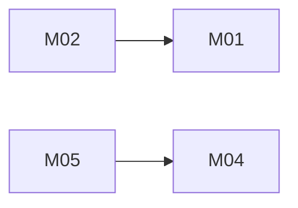

# Unified Identity: architecture

Version: 2026-11-05 · Status: approved · Structured copy: `architecture.json`

## Architecture style

| Style | Fit | Why |
| --- | --- | --- |
| modular monolith | good | one required in-process interface, strong consistency, no infrastructure |
| microservices | poor | network calls and distributed data for three small features |
| service-oriented | poor | no existing system that must stay separate |
| event-driven | poor | role changes and sign-in must be consistent immediately |
| hybrid | poor | nothing needs a second style |

Selected: modular monolith, because the task fixes one module
(`app/unified/identity.py`) and every operation must see the same data at once.

## Stack

| Layer | Choice | Why (decision id) |
| --- | --- | --- |
| Frontend | none (library) | no UI in scope |
| Backend | Python 3.8+ standard library | task constraint (D02) |
| Database | in-memory store per app instance, locked | sources are in-memory; no persistence in the interface (D01) |
| Hosting | none | no deployment |

## Modules

All modules are classes or sections inside `app/unified/identity.py` (the
required single import path); boundaries are kept by each class owning its data.

| Module | Responsibility | Features | Depends on | Owns entities |
| --- | --- | --- | --- | --- |
| config | settings with defaults and env overrides | - | - | - |
| access-control | roles, permission table, can(), map_source_role | M04 | - | - |
| accounts | users, email ownership, password hashing, register, bootstrap admin | M01 | config, access-control | User |
| sessions | password login, tokens, whoami, logout, expiry | M02 | config, accounts | Session |
| federation | OAuth sign-in and verified-email linking | M03 | accounts, sessions, access-control | Identity |
| role-admin | admin-only role changes, no self-raise | M05 | sessions, accounts, access-control | - |

### Feature dependency map

## Data model

| Entity | Merged from | Primary key | Key fields | Notes |
| --- | --- | --- | --- | --- |
| User | A:User, B:Account | id (uuid4 hex text) | email, email_owner, password_hash, role, legacy_id, created_at | one per person |
| Identity | new (B:Account.provider, B:Account.subject) | (provider, subject) | user_id, email_verified | many identities per user |
| Session | A:Session | token | user_id, expires_at | revoked on logout |

Email is stored lowercased and trimmed. A user "owns" its email when it was
registered with a password or created by a verified OAuth sign-in; an
unverified OAuth account never owns an email, so it cannot block or capture
another account. At most one user owns a given email.

Migrations from source data: none run. Both sources keep data in memory
only; the approved plan (re-key with legacy_id) is in `migration-plan.md`.

## Authentication and authorization

Sign-in: `register_password`/`login_password` (A) and `login_oauth` (B),
both returning the same opaque session token (`secrets.token_urlsafe(32)`),
held server-side with a 12-hour expiry and revoked by `logout`.

`login_oauth(provider, subject, email, email_verified)`:
1. A known (provider, subject) signs in to its linked user.
2. Otherwise, if `email_verified is True` and a user owns that email, the identity is linked to that user (role kept).
3. Otherwise a new user is created with role viewer; it owns the email only if verified and nobody owns it yet.

Authorization: one `can(role, permission)` check; roles viewer {read},
editor {read, write}, admin {read, write, manage_roles}. `set_role`
resolves the caller from the token, requires manage_roles, validates the
role, and refuses any change that raises the caller's own role.
`bootstrap_admin` works only while no admin exists.

| Source role | Unified role | Extra permissions |
| --- | --- | --- |
| A user | editor | - |
| B member | viewer | - |
| C viewer | viewer | - |
| C editor | editor | - |
| C admin | admin | manage_roles (part of the role) |

## API

In-process Python API (no HTTP in scope). Errors: `AuthError` for sign-in
and token failures; `PermissionError` for authorization; `KeyError` for
unknown role mappings and unknown users; `ValueError` for invalid input.
Errors that fit two families subclass both (for example duplicate email:
AuthError and ValueError; bad token on set_role: AuthError and PermissionError).

| Method | Path | Module | Auth | Features |
| --- | --- | --- | --- | --- |
| call | `create_app()` | config | none | - |
| call | `register_password(email, password)` | accounts | none | M01 |
| call | `login_password(email, password)` | sessions | none | M02 |
| call | `login_oauth(provider, subject, email, email_verified)` | federation | caller-verified provider response | M03 |
| call | `whoami(token)` / `logout(token)` | sessions | token | M02 |
| call | `map_source_role(source_app, role)` | access-control | none | M04 |
| call | `set_role(token, user_id, role)` | role-admin | admin token | M05 |
| call | `bootstrap_admin(email, password)` | accounts | setup only | M05 |

## Navigation

No screens in scope.

## Design system

No UI in scope; nothing visual taken from any source.

## Configuration

| Variable | Purpose | Default |
| --- | --- | --- |
| IDENTITY_PBKDF2_ITERATIONS | password hash iterations | 310000 |
| IDENTITY_SESSION_TTL_SECONDS | session lifetime | 43200 |

`create_app(**overrides)` accepts the same settings. No secrets are needed.

## Error handling

Sign-in failures give one message ("invalid credentials") so they do not
reveal which emails exist. Messages never contain passwords or tokens.
Nothing is logged.

## Roadmap

| Slice | Features | Done when | Status |
| --- | --- | --- | --- |
| V1 | M01, M02, M03 | password and OAuth sign-in, linking rule, whoami, logout tested | done |
| V2 | M04, M05 | role mapping, permissions, set_role rules, bootstrap tested | done |

## Decisions

| Id | Decision | Reason | Approved |
| --- | --- | --- | --- |
| D01 | modular monolith in one file | required interface | benchmark operator (pre-approved) |
| D02 | stdlib only, unittest | task constraint | yes |
| D03 | uuid text ids; Identity and Session entities | compat decision | benchmark operator (pre-approved) |
| D04 | join only on verified email | user decision | user |
| D05 | role mapping | user decision | user |
| D06 | set_role rules | user decision + C-E03 | user / benchmark operator |
| D07 | bootstrap_admin only while no admin exists | setup only | benchmark operator (pre-approved) |
| D08 | server-side tokens with expiry and logout | A-E04 | benchmark operator (pre-approved) |
| D09 | PBKDF2-SHA256 310k, constant-time compare | A-E01, A-E03 | benchmark operator (pre-approved) |
| D10 | reject duplicate email | A-E02 | benchmark operator (pre-approved) |
