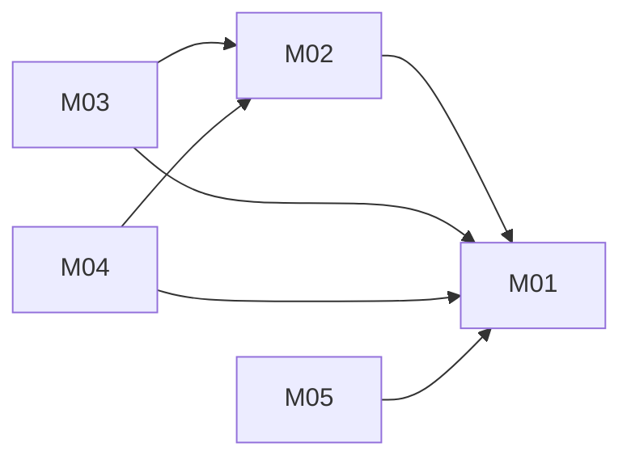

# Unified Billing: architecture

Version: 2026-11-05 · Status: approved (benchmark operator, pre-approved) · Structured copy: `architecture.json`

## Architecture style

| Style | Fit | Why |
| --- | --- | --- |
| modular monolith | good | one module required; invariants need one consistent store |
| microservices | poor | exactly-once rules would become distributed transactions |
| service-oriented | poor | nothing must stay separate |
| event-driven | partial | webhooks are events but are handled as idempotent commands |
| hybrid | poor | no part needs a second style |

Selected: modular monolith, because of the drivers above.

## Stack

| Layer | Choice | Why (decision id) |
| --- | --- | --- |
| Frontend | none | library (D11) |
| Backend | Python 3.8+ stdlib, `app/unified/billing.py` | user's interface (D11) |
| Database | in-memory `Store`, all-or-nothing writes | user's store contract (D06, D12) |
| Hosting | none | no deployment |

## Modules

Sections of `billing.py`:

| Module | Responsibility | Features | Depends on | Owns entities |
| --- | --- | --- | --- | --- |
| store | atomic writes, fail_next_write | - | - | - |
| orders | create_order, order, ledger, transitions | M01 | store | Order, LedgerEntry |
| payments | pay | M02 | orders, store | PaymentAttempt |
| refunds | cancel, refund guard | M04 | orders, store | RefundRecord |
| webhooks | handle_webhook | M03 | orders, refunds, store | ProcessedEvent |
| subscriptions | renew | M05 | orders, store | Renewal |
| app | create_app facade, lock | - | all | - |

### Feature dependency map

## Data model

| Entity | Merged from | Primary key | Key fields | Notes |
| --- | --- | --- | --- | --- |
| Order | A:Order, C:Order | id ord_<n> | customer, amount_cents, status, charge_id | status check: pending/paid/cancelled/refunded |
| LedgerEntry | new | position | order_id, kind, amount_cents | append-only |
| PaymentAttempt | A:Order | key | order_id; first key per order | D03 |
| RefundRecord | new | order_id | charge_id, state, refund_id | D05 |
| ProcessedEvent | new | event id | - | D04 |
| Renewal | B:Subscription | (subscription id, period) | order_id | D08 |

Transitions: pending->paid, pending->cancelled, paid->refunded, cancelled->refunded (late charge only, D13).
Migrations from source data: none; no source persists data.

## Authentication and authorization

None: an in-process library called by trusted server code. Webhook signature checking belongs to the
HTTP layer, which is out of scope (mock gateway).

| Source role | Unified role | Extra permissions |
| --- | --- | --- |
| (none in any source) | caller | all operations |

## API

Python API (no HTTP): `create_app(gateway, store=None)`, `create_order`, `pay`, `handle_webhook`, `cancel`,
`order`, `ledger`, `renew`. Errors: `StoreError`, `GatewayTimeout` (re-exported), `BillingError`
subclasses `OrderNotFound`, `InvalidState`, `IdempotencyKeyReused` (all `ValueError`/`KeyError` compatible).

| Method | Path | Module | Auth | Features |
| --- | --- | --- | --- | --- |
| (none) | (library) | app | - | M01-M05 |

## Navigation

None (no UI).

## Design system

None (no UI).

## Configuration

None; the gateway and store are injected.

## Error handling

Every state change is one atomic write; StoreError leaves state untouched. Gateway timeouts re-raise with the
attempt recorded so a retry with any key reuses the first gateway key. A refund record is written before
`gateway.refund`, so refunds are never repeated.

## Roadmap

| Slice | Features | Done when | Status |
| --- | --- | --- | --- |
| V1 | M01, M02 | AC01-AC04 pass | pending |
| V2 | M03 | AC05-AC07 pass | pending |
| V3 | M04 | AC08-AC10 pass | pending |
| V4 | M05 | AC11 passes | pending |

## Decisions

| Id | Decision | Reason | Approved |
| --- | --- | --- | --- |
| D01-D10 | see compat/resolutions.json | compatibility | benchmark operator |
| D11 | stdlib Python, one module | user's interface | benchmark operator |
| D12 | Store or flag-only store object | user's store contract | benchmark operator |
| D13 | late charge on a cancelled order is refunded once | no money kept for cancelled orders | benchmark operator |
