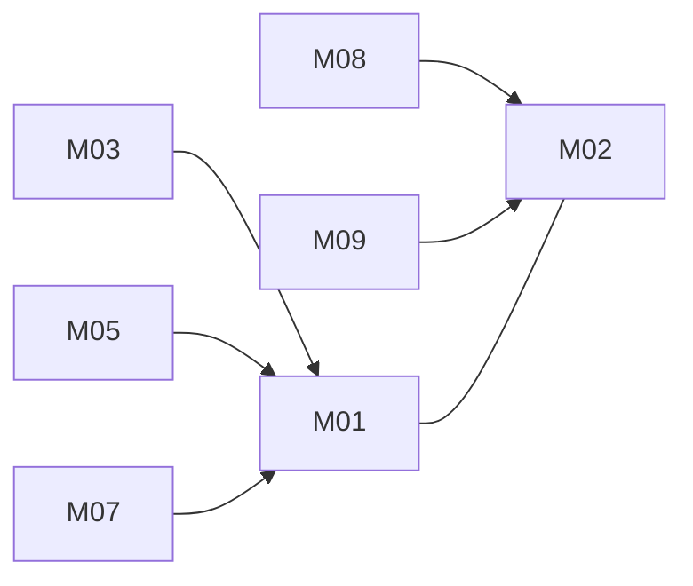

# Unified Notes: architecture

Version: 2026-11-04 · Status: approved (benchmark-operator, pre-approved in task) · Structured copy: `architecture.json`

## Architecture style

| Style | Fit | Why |
| --- | --- | --- |
| modular monolith | good | one user, one process, one SQLite file; notes and tags need strong consistency |
| microservices | poor | six small features over one table; network and ops cost for nothing |
| service-oriented | poor | no existing system that must stay separate |
| event-driven | poor | nothing asynchronous; export is a synchronous read |
| hybrid | poor | no part needs a second style |

Selected: modular monolith, because the drivers are a single user, a small codebase, strong consistency and no independent scaling or release need.

## Stack

| Layer | Choice | Why (decision id) |
| --- | --- | --- |
| Frontend | static HTML + vanilla JS served by Flask | no source UI to reuse, no build step (D03) |
| Backend | Python 3.11+, Flask 3 | A's runtime; one runtime (D01) |
| Database | SQLite via standard-library sqlite3 | persistent, relational, no server (D02) |
| Markdown | Python-Markdown 3 + nh3 | sanitised preview (D04) |
| Hosting | local process on 127.0.0.1 | personal app, no deployment (D05) |

Packages to install at implementation time (needs an `install-dependencies` approval; none given yet): Flask, Markdown, nh3. B's express and uuid are not used (Python's `uuid` module replaces uuid).

## Modules

| Module | Responsibility | Features | Depends on | Owns entities |
| --- | --- | --- | --- | --- |
| core | config, DB connection, schema runner, error format, validation | - | - | - |
| notes | Note CRUD, list order | M01, M02 | core | Note |
| tags | tags, tagging, tag filter | M03 | core, notes | Tag, NoteTag |
| search | title and body search | M05 | core, notes | - |
| preview | Markdown to sanitised HTML | M07 | core, notes | - |
| pinning | pin and unpin | M08 | core, notes | - |
| export | Markdown export with front matter | M09 | core, notes, tags | - |

### Feature dependency map

## Data model

| Entity | Merged from | Primary key | Key fields | Notes |
| --- | --- | --- | --- | --- |
| Note | A:Note, B:Note | id uuid | legacy_id, title (1-200), body (A.body / B.content), pinned, created_at, updated_at (B.updatedAt) | index (pinned desc, created_at desc) |
| Tag | A:Tag (+ B labels) | id uuid | legacy_id, name (case-insensitive unique) | |
| NoteTag | A:NoteTag | (note_id, tag_id) | both cascade on delete | index on tag_id |

Full DDL: `schema.sql`. Migrations from source data: see `migration-plan.md`.
Re-keying A's notes, tags and note_tags to uuid is high risk (ids change);
B's labels move into tags (duplicates collapse). Approved as plans only
(A02); nothing may run without a `migration` approval.

## Authentication and authorization

Neither source has authentication. The unified app is a single-user local
app: no sign-in, no session, server bound to 127.0.0.1 (D05). One role,
`owner`, with every permission. If the app is ever hosted, accounts and
http-only cookie sessions must be added first (open question).

| Source role | Unified role | Extra permissions |
| --- | --- | --- |
| A: (no roles) | owner | all |
| B: (no roles) | owner | all |

## API

REST, `/api/v1`, JSON, one error shape `{"error": {"code", "message"}}`, no
pagination in V1, no auth (localhost). Full table in `api.md`.

| Method | Path | Module | Auth | Features |
| --- | --- | --- | --- | --- |
| GET | `/api/v1/notes` | notes | none | M01, M02 |
| POST | `/api/v1/notes` | notes | none | M01, M02 |
| GET | `/api/v1/notes/{id}` | notes | none | M01, M02 |
| PUT | `/api/v1/notes/{id}` | notes | none | M01, M02 |
| DELETE | `/api/v1/notes/{id}` | notes | none | M01, M02 |
| GET | `/api/v1/tags` | tags | none | M03 |
| POST | `/api/v1/notes/{id}/tags` | tags | none | M03 |
| DELETE | `/api/v1/notes/{id}/tags/{tag}` | tags | none | M03 |
| GET | `/api/v1/search` | search | none | M05 |
| GET | `/api/v1/notes/{id}/preview` | preview | none | M07 |
| POST | `/api/v1/notes/{id}/pin` | pinning | none | M08 |
| DELETE | `/api/v1/notes/{id}/pin` | pinning | none | M08 |
| GET | `/api/v1/export` | export | none | M09 |

## Navigation

| Route | Screen | Module |
| --- | --- | --- |
| `/` | Notes list: search box, tag filter, pinned section | notes |
| `/notes/new` | New note editor | notes |
| `/notes/{id}` | Editor with preview pane, tags, pin toggle | notes |

## Design system

Tokens: colour roles bg, surface, text, muted, accent, danger (light and
dark); type scale 14/16/20/28; spacing 4/8/16/24/32; radius 4/8. Components:
NoteListItem (default, pinned), SearchBox, TagChip (default, removable),
Editor, PreviewPane, Button (primary, secondary, danger), EmptyState. System
font stack, no icon set (text labels). Nothing visual taken from the sources
(they have no UI).

## Configuration

| Variable | Purpose | Default |
| --- | --- | --- |
| NOTES_DB_PATH | SQLite file | `./data/notes.db` |
| NOTES_HOST | bind address | `127.0.0.1` |
| NOTES_PORT | port | `5000` |

Read in `core/config.py` only; `.env.example` lists names without values. No secrets are needed.

## Error handling

Every error uses the one shape; 400 validation, 404 unknown id. Unknown ids
never crash (B did). Logs record method, path, status and duration only,
never note content.

## Roadmap

| Slice | Features | Done when | Status |
| --- | --- | --- | --- |
| V1 | M01, M02 | AC01-AC04 pass; list and editor screens work | pending |
| V2 | M03, M05 | AC05-AC08 pass | pending |
| V3 | M07, M08, M09 | AC09-AC11 pass | pending |

## Decisions

| Id | Decision | Reason | Approved |
| --- | --- | --- | --- |
| D01 | Python + Flask | A's runtime; one runtime | yes (operator) |
| D02 | SQLite | persistent, relational, no server | yes (operator) |
| D03 | static HTML + vanilla JS | no source UI, no build step | yes (operator) |
| D04 | Python-Markdown + nh3 | sanitised preview | yes (operator) |
| D05 | local single user, no auth | neither source has accounts | yes (operator) |
| D06 | modular monolith | see style | yes (operator) |
| D07 | REST /api/v1, one error shape | both sources are REST | yes (operator) |
| D08 | uuid keys + legacy_id; pinned-first then newest; whitelisted update | compatibility resolutions | yes (operator) |
