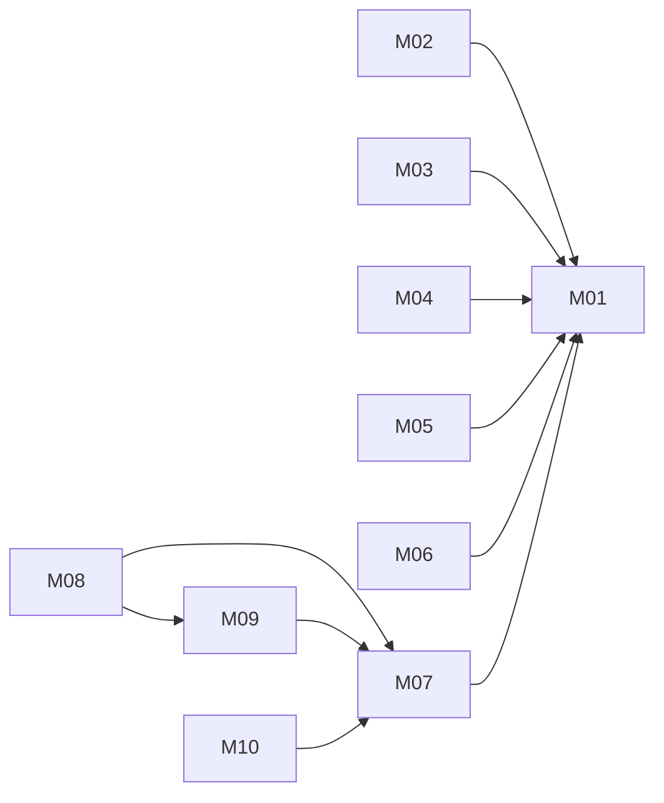

# FileShare: architecture

Version: 2026-11-04 · Status: approved (benchmark-operator, pre-approved in task) · Structured copy: `architecture.json`

## Architecture style

| Style | Fit | Why |
| --- | --- | --- |
| modular monolith | good | one developer, one process, files and links must stay consistent |
| microservices | poor | network and distributed data for three tiny capabilities |
| service-oriented | poor | no existing systems to keep separate |
| event-driven | poor | nothing asynchronous; deletes must cascade at once |
| hybrid | poor | no part needs a second style |

Selected: modular monolith, because of one team, strong consistency and no scaling need.

## Stack

| Layer | Choice | Why (decision id) |
| --- | --- | --- |
| Frontend | two static HTML pages + vanilla JS, system fonts | no build tools (D08) |
| Backend | Python 3 stdlib WSGI app, wsgiref server | stdlib only, in-process tests (D01, D04) |
| Database | SQLite, foreign keys on | stdlib, cascades (D03) |
| Hosting | local process only | deployment not requested |

## Modules

| Module | Responsibility | Features | Depends on | Owns entities |
| --- | --- | --- | --- | --- |
| core | config, db + schema, HTTP helpers, errors, hashing | - | - | - |
| accounts | register, login, logout, sessions, current user | - | core | User, Session |
| files | upload, list, delete, content; ownership check | M01, M02, M03 | core, accounts | File, FileContent |
| preview | text / image / none preview | M04, M05, M06 | core, files | - |
| sharing | create, open, revoke links; expiry; password | M07, M08, M09, M10 | core, accounts, files, preview | ShareLink |
| web | routing table, HTML pages | - | all | - |

### Feature dependency map

## Data model

| Entity | Merged from | Primary key | Key fields | Notes |
| --- | --- | --- | --- | --- |
| User | new | id text | username unique, password_hash | added for owner identity |
| Session | new | token text | user_id → User (cascade), expires_at | 7-day sessions |
| File | A:File, B:File | id text (uuid4 hex) | owner_id → User, name, size ≤ 10485760, content_type, created_at | indexed (owner_id, created_at) |
| FileContent | B:File (data) | file_id text | data blob | → File, cascade |
| ShareLink | C:ShareLink | token text | file_id → File (cascade), expires_at, password_hash | indexed file_id |

Migrations from source data: none. No source persists data that exists (A's store is absent, B and C are
in-memory), so the schema in `schema.sql` is created from empty. The script flagged `migration:file` as
destructive (key/type unification); approved as A01 as a schema decision only (`migration-plan.md`).

## Authentication and authorization

Username + password, salted PBKDF2-HMAC-SHA256 (200 000 iterations); sessions are random tokens stored
server-side and sent in an http-only SameSite=Strict cookie. Roles: `user` (owns files) and `link-holder`
(anonymous with a valid token). One function, `files.get_owned_file(db, user, file_id)`, answers "may this
user touch this file"; every owner route and link create/revoke uses it, and foreign files answer 404.

| Source role | Unified role | Extra permissions |
| --- | --- | --- |
| A: caller-supplied owner_id | user | - |
| B: none | user | - |
| C: token holder | link-holder | read one file while the link is valid |

## API

REST, JSON, `/api`, error shape `{"error": {"code", "message"}}`, no pagination, cookie auth for owner
endpoints, token (+ `X-Link-Password`) for share endpoints. Full detail in `api.md`.

| Method | Path | Module | Auth | Features |
| --- | --- | --- | --- | --- |
| POST | /api/register | accounts | none | - |
| POST | /api/login | accounts | none | - |
| POST | /api/logout | accounts | session | - |
| GET | /api/files | files | session | M02 |
| POST | /api/files | files | session | M01 |
| DELETE | /api/files/{id} | files | owner | M03 |
| GET | /api/files/{id}/content | files | owner | M05 |
| GET | /api/files/{id}/preview | preview | owner | M04, M05, M06 |
| POST | /api/files/{id}/links | sharing | owner | M07, M08 |
| DELETE | /api/links/{token} | sharing | owner of file | M10 |
| GET | /api/share/{token} | sharing | token | M08, M09 |
| GET | /api/share/{token}/content | sharing | token | M09 |

## Navigation

| Route | Screen | Module |
| --- | --- | --- |
| / | My files | web |
| /s/{token} | Shared file | web |

## Design system

Tokens: colours bg #f7f7f5, surface #fff, text #1d1d1b, muted #5c5c57, accent #1f5f8b, danger #a3271b;
system-ui font stack; type scale 14/16/20/28; spacing 4/8/16/24; radius 6. Components: button (primary,
danger, plain), text input, file input, file row, preview panel (text, image, none), notice (info, error).
No external fonts or icons.

## Configuration

`FILESHARE_DB` (SQLite path, default `./fileshare.sqlite3`), `FILESHARE_HOST` (127.0.0.1),
`FILESHARE_PORT` (8000), `FILESHARE_SECURE_COOKIE` (0). Read in `fileshare/config.py`; `.env.example`
lists the names. No secrets are needed.

## Error handling

Every error is JSON `{"error": {"code", "message"}}` with a fitting status (400, 401, 403, 404, 405, 411,
413). Unknown and expired links are both 404. Logs hold method, path template and status only; no
usernames, passwords, tokens or file contents.

## Roadmap

| Slice | Features | Done when | Status |
| --- | --- | --- | --- |
| V1 | M01, M02, M04, M06 | sign in, upload, list, text/none preview tested | pending |
| V2 | M07, M09 | create and open links tested | pending |
| V3 | M03, M05, M08, M10 | delete, image preview, password, revoke tested | pending |

## Decisions

| Id | Decision | Reason | Approved |
| --- | --- | --- | --- |
| D01 | stdlib only | operator constraint | yes |
| D02 | modular monolith | style table | yes |
| D03 | SQLite with cascades | stdlib, consistency | yes |
| D04 | WSGI + wsgiref, in-process tests | no network | yes |
| D05 | PBKDF2 accounts, cookie sessions | identity conflict | yes |
| D06 | REST JSON, one error shape | one client | yes |
| D07 | raw-body upload, Content-Length check | no multipart parser in 3.13 stdlib | yes |
| D08 | static pages, vanilla JS | no build tools | yes |
| D09 | link password in header | keep secrets out of URLs | yes |
