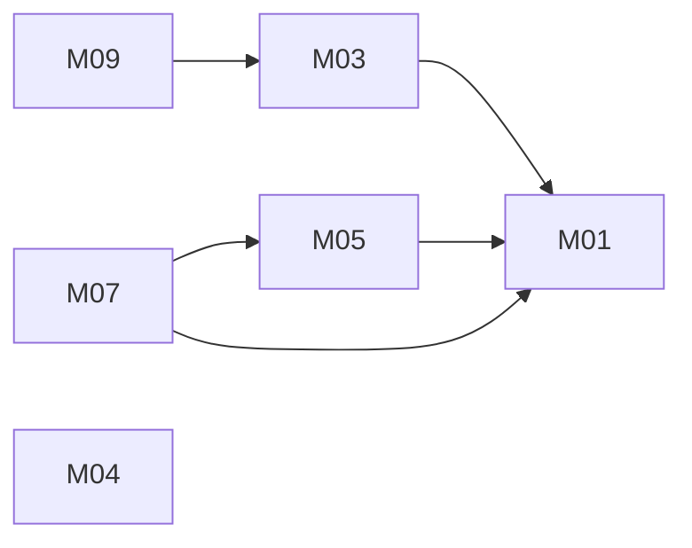

# Unified Community Forum: architecture

Version: 2026-11-04 · Status: approved (benchmark-operator, pre-approved in task) · Structured copy: `architecture.json`

## Architecture style

| Style | Fit | Why |
| --- | --- | --- |
| modular monolith | good (selected) | one small product, one release cadence, posts and moderation need strong consistency |
| microservices | poor | network and distributed data cost with no scaling or team need |
| service-oriented | poor | no existing system must stay separate |
| event-driven | poor | moderation is synchronous; no async fan-out |
| hybrid | partial | an async notification pipeline could be added later; not needed now |

Selected: modular monolith, because of one team, one release cadence, strong consistency and modest uniform load.

## Stack

| Layer | Choice | Why (decision id) |
| --- | --- | --- |
| Frontend | server-rendered EJS pages | five screens, no known source frontend (D03) |
| Backend | Node.js 22 LTS, Express 4 | A's stack, its code may be adapted (D01) |
| Database | PostgreSQL 16, uuid keys | A's schema style, compatibility decision (D02) |
| Sessions | express-session + PostgreSQL store | one http-only cookie session (D04) |
| Hosting | one managed Node host + managed PostgreSQL | user's choice; nothing deployed by Feature Mixer |

## Modules

| Module | Responsibility | Features | Depends on | Owns entities |
| --- | --- | --- | --- | --- |
| config | env vars read once | - | - | - |
| identity | accounts, sessions, roles, can() | M01 | config | User, Session |
| posts | create (pending), read with visibility, list published | M03, M04, M05, M09 | identity, config | Post |
| moderation | queue and decisions via posts' API | M07 | posts, identity | - |

### Feature dependency map

## Data model

| Entity | Merged from | Primary key | Key fields | Notes |
| --- | --- | --- | --- | --- |
| User | A:User, B:User | id uuid | legacy_id int (B), email unique, display_name (A display_name / B name), role member/moderator, password_hash, password_reset_required, sign_in_disabled, created_at | same-email accounts merged; reserved system account for legacy anonymous posts |
| Post | A:Post, B:Post | id uuid | legacy_id int (B), author_id uuid not null → User (on delete restrict), body ≤ 10000, status pending/published/rejected, created_at, moderated_by → User, moderated_at | indexes: (status, created_at desc), author_id, moderated_by |
| Session | new | sid text | sess jsonb, expire | session store |

Full DDL: `schema.sql`. Migrations from source data: `migration-plan.md` (migration:post and migration:user, high risk because of re-keying and account merging; approved as plans only, A02/A03; nothing has run).

## Authentication and authorization

One identity system (own users table), email + password with argon2id, server-side session in an http-only, secure, same-site=lax cookie, CSRF tokens on form posts. Roles member and moderator; every handler and query goes through `identity.can(user, action, resource)`. Permissions: post.create, post.read_published, post.read_own_unpublished, post.read_any_unpublished, moderation.list, moderation.decide (see architecture.json).

| Source role | Unified role | Extra permissions |
| --- | --- | --- |
| A member | member | - |
| A moderator | moderator | moderation.list, moderation.decide, post.read_any_unpublished |
| B user | member | - |
| B admin | member | none; listed for the user to promote (least privilege) |

## API

REST JSON under `/api`, no version prefix yet (v1 implied; a breaking change adds `/api/v2`). Errors `{"error": {"code", "message"}}`; cursor pagination `?cursor=&limit=` (max 50); one cookie-session auth. Full spec: `api.md`.

| Method | Path | Module | Auth | Features |
| --- | --- | --- | --- | --- |
| POST | /api/session | identity | none | M01 |
| GET | /api/session | identity | session | M01 |
| DELETE | /api/session | identity | session | M01 |
| GET | /api/posts | posts | public (published only) | M09 |
| POST | /api/posts | posts | post.create | M05 |
| GET | /api/posts/:id | posts | public if published, else author/moderator | M03, M04 |
| GET | /api/moderation/queue | moderation | moderation.list | M07 |
| POST | /api/moderation/posts/:id/decision | moderation | moderation.decide | M07 |

## Navigation

| Route | Screen | Module |
| --- | --- | --- |
| /login | Login | identity |
| /posts | Post list | posts |
| /posts/new | New post | posts |
| /posts/:id | Post | posts |
| /moderation | Moderation queue (moderators only in the menu) | moderation |

## Design system

Tokens: colour roles surface, text, muted, accent, danger, success, border; type scale 14/16/20/28; spacing 4/8/12/16/24/32; radius 4/8. Components: Button (primary, secondary, danger), TextField (default, error), TextArea (default, error, with counter), PostCard (published, pending, rejected), StatusBadge, EmptyState, Alert (error, success). System font stack; no icons required. Nothing visual is taken from either source.

## Configuration

| Variable | Purpose | Default |
| --- | --- | --- |
| DATABASE_URL | PostgreSQL connection (secret) | none |
| SESSION_SECRET | signs the session cookie (secret) | none; required in production |
| PORT | HTTP port | 3000 |
| NODE_ENV | development / production (secure cookies) | development |
| MAX_POST_LENGTH | body limit | 10000 |
| SESSION_IDLE_DAYS | session idle timeout | 7 |

Read once in the config module; `.env.example` lists names only; secrets live in the host's secret store, never in code or logs. B's hard-coded signing key is not carried over.

## Error handling

One error shape; 401 not signed in, 403 not allowed, 404 missing or not visible, 409 already decided, 422 invalid input. Logs carry request id, route, status and user id only; no bodies, emails or secrets. No external services, so no retries.

## Roadmap

| Slice | Features | Done when | Status |
| --- | --- | --- | --- |
| V1 | M01, M05, M03, M04 | AC01-AC06 pass | pending |
| V2 | M07 | AC07-AC08 pass | pending |
| V3 | M09 | AC09 pass | pending |

## Decisions

| Id | Decision | Reason | Approved |
| --- | --- | --- | --- |
| D01 | Node 22 + Express 4 | A's stack, reusable code | yes (operator) |
| D02 | PostgreSQL 16, uuid + legacy_id | compatibility decision | yes (operator) |
| D03 | server-rendered EJS | five screens | yes (operator) |
| D04 | http-only cookie session | compatibility decision | yes (operator) |
| D05 | argon2id; reset unsupported B hashes | security engine | yes (operator) |
| D06 | modular monolith | style comparison | yes (operator) |
| D07 | roles member/moderator; B admin -> member | least privilege | yes (operator) |
| D08 | REST, one error shape, cursor pagination | one API style | yes (operator) |
| D09 | limit 10000; pre-moderation; B posts published | compatibility decisions | yes (operator) |
