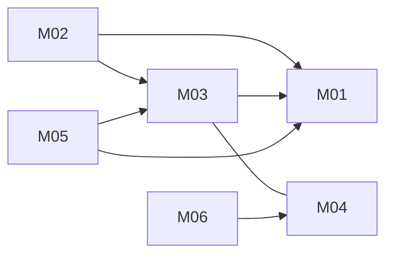

# Unified CRM: architecture

Version: 2026-11-04 · Status: approved (benchmark-operator, pre-approved in task) · Structured copy: `architecture.json` · Schema: `schema.sql` · API: `api.md` · Migration: `migration-plan.md`

## Architecture style

| Style | Fit | Why |
| --- | --- | --- |
| modular monolith | good (selected) | one small team and release cadence; contact merge needs one transaction across contacts and deals; low volume |
| microservices | poor | network calls and distributed data with no independent scaling or team need |
| service-oriented | poor | no existing systems that must stay separate |
| event-driven | partial | reminders are asynchronous, but one daily low-volume job does not justify message infrastructure |
| hybrid | partial | a second set of rules for a single job |

Selected: modular monolith, because one team, strong consistency for merges,
no scaling split, and the only async work is one scheduled command.

## Stack

| Layer | Choice | Why (decision id) |
| --- | --- | --- |
| Frontend | Server-rendered Django templates, small vanilla JS for the deal board | no UI source in either app; React/lodash dropped (D02) |
| Backend | Python 3.12, Django 5.2 LTS | both sources are Python; brings auth, sessions, ORM, migrations (D01) |
| Database | PostgreSQL 16; SQLite for dev and tests | transactions, uuid keys (D03) |
| Jobs | `send_stale_reminders` management command run daily by cron | one low-volume job (D04) |
| Email | Django email backend over SMTP; locmem in tests | injectable mailer like B's (D05) |
| Hosting | not chosen (no constraint given; no deployment) | - |

## Modules

| Module | Responsibility | Features | Depends on | Owns entities |
| --- | --- | --- | --- | --- |
| accounts | users, sign-in, sessions, roles, `can(user, action, record)` | - | - | User |
| contacts | create, edit, list, search contacts | M01 | accounts | Contact |
| pipeline | deals, configurable stages, moves with moved_at | M03, M04 | accounts, contacts | Deal, Stage |
| contact-merge | transactional duplicate merge with audit | M02 | accounts, contacts, pipeline | ContactMerge |
| reporting | CSV exports | M05 | accounts, contacts, pipeline | - |
| reminders | daily stale-deal job and send log | M06 | accounts, pipeline | ReminderLog |

contact-merge is its own module so that contacts never imports pipeline
(pipeline already depends on contacts for Deal.contact_id): no cycles (D06).

### Feature dependency map

(M03 and M04 are one unified feature, U03.)

## Data model

| Entity | Merged from | Primary key | Key fields | Notes |
| --- | --- | --- | --- | --- |
| User | new | uuid | email (unique, ci), name, password (hash), role | created from B's owner_email values |
| Contact | A:Contact | uuid | name, email (unique, ci), company, legacy_source, legacy_id | A's integer id kept as legacy_id |
| Stage | new | uuid | name, position, outcome (open/won/lost/unspecified), is_active | replaces A's STAGES and B's stages parameter (D08) |
| Deal | A:Deal, B:Deal | uuid | contact_id (nullable, set null), title, value_cents + currency, stage_id, moved_at (UTC), owner_id, legacy ids | union of both sources' fields |
| ContactMerge | new | uuid | kept_contact_id, dropped_contact_legacy (json snapshot), deals_moved, merged_by | audit for M02 |
| ReminderLog | new | uuid | deal_id, moved_at, sent_to; unique (deal_id, moved_at) | dedupe for M06 |

Indexes on every foreign key and on deal.moved_at, contact lower(name),
lower(email). Check constraints for role, outcome, currency, title length,
non-negative value.

Migrations from source data: see `migration-plan.md`. Both migration:deal
(re-key, stage text to stage_id, owner_email to owner_id, title cast) and
migration:contact (re-key) are high risk and approved as plans only (A02,
A04); nothing runs in this run, and the import writes to a new database
only, so the sources are never modified.

## Authentication and authorization

Django auth with email and password, slow password hashing, server-side
sessions in http-only, secure, SameSite=Lax cookies, CSRF on every unsafe
request, login rate limiting. Roles `admin` and `member`; special powers are
permissions (`contacts.merge`, `stages.configure`, `users.manage` for admin;
read/write contacts and deals, move deals, download exports for members).
Every view and query goes through `accounts.can(user, action, record)` (D09).

| Source role | Unified role | Extra permissions |
| --- | --- | --- |
| A: none (no auth in source) | member | - |
| B: deal owner (owner_email) | member | - |
| (new) team lead | admin | contacts.merge, stages.configure, users.manage |

## API

REST JSON under `/api/v1`; error shape `{"error": {"code", "message"}}`;
cursor pagination; session auth everywhere except login (D10). Full table
in `api.md`.

| Method | Path | Module | Auth | Features |
| --- | --- | --- | --- | --- |
| POST | /api/v1/auth/login | accounts | none | - |
| POST | /api/v1/auth/logout | accounts | session | - |
| GET | /api/v1/me | accounts | session | - |
| GET, POST | /api/v1/contacts | contacts | session | M01 |
| GET, PATCH | /api/v1/contacts/{id} | contacts | session | M01 |
| POST | /api/v1/contacts/{id}/merge | contact-merge | contacts.merge | M02 |
| GET, POST | /api/v1/deals | pipeline | session | M03, M04 |
| GET, PATCH | /api/v1/deals/{id} | pipeline | session | M03, M04 |
| POST | /api/v1/deals/{id}/move | pipeline | session | M03, M04 |
| GET, POST | /api/v1/stages | pipeline | GET session, POST stages.configure | M04 |
| PATCH | /api/v1/stages/{id} | pipeline | stages.configure | M04 |
| GET | /api/v1/exports/contacts.csv | reporting | exports.download | M05 |
| GET | /api/v1/exports/deals.csv | reporting | exports.download | M05 |
| GET | /api/v1/reminders/log | reminders | admin | M06 |

## Navigation

| Route | Screen | Module |
| --- | --- | --- |
| /login | Sign in | accounts |
| /contacts | Contact list and search | contacts |
| /contacts/new | New contact | contacts |
| /contacts/{id} | Contact detail with its deals | contacts |
| /contacts/{id}/merge | Merge duplicate contact | contact-merge |
| /deals | Deal board by stage | pipeline |
| /deals/{id} | Deal detail | pipeline |
| /settings/stages | Stage settings | pipeline |
| /exports | Exports | reporting |
| /settings/reminders | Reminder settings and log | reminders |

## Design system

Tokens: colour roles bg, surface, text, muted, accent, danger, success,
border (the user's own brand colours; nothing taken from a source); type
scale 14/16/20/24/32 px on the system font stack; spacing on a 4 px base;
radius 4 px controls, 8 px cards. Components: Button (primary, secondary,
danger), TextField (default, error), Table (default, empty), DealCard (open,
won, lost, closed-unspecified), StageColumn (default, drop-target), Banner
(info, error, success). Icons: Lucide (ISC).

## Configuration

All read in one `config/settings.py` from environment variables;
`.env.example` lists names only.

| Variable | Purpose | Default |
| --- | --- | --- |
| DATABASE_URL | database connection | SQLite file in dev |
| SECRET_KEY | Django signing key (secret) | none in production |
| ALLOWED_HOSTS | served host names | localhost |
| EMAIL_HOST, EMAIL_PORT, EMAIL_HOST_USER, EMAIL_HOST_PASSWORD | SMTP (password is secret) | port 587 |
| DEFAULT_FROM_EMAIL | reminder sender | none |
| REMINDER_STALE_DAYS | days before a reminder | 14 |
| DEFAULT_CURRENCY | currency for value_cents | USD |

## Error handling

One error shape; validation errors list fields; unknown or inactive stage
returns 400 `unknown_stage` (A's and B's ValueError); permission failures
403; missing records 404. Logs carry request ids, never contact emails or
secrets. SMTP failures in the reminder job are logged per deal and retried
on the next run (no ReminderLog row is written for a failed send).

## Roadmap

| Slice | Features | Done when | Status |
| --- | --- | --- | --- |
| V1 | M01, M03, M04 | sign in, add/search a contact, create a deal, move it through seeded and custom stages; AC01-AC05 pass | pending |
| V2 | M02 | AC06-AC08 pass | pending |
| V3 | M05 | AC09-AC10 pass | pending |
| V4 | M06 | AC11-AC12 pass | pending |

## Decisions

| Id | Decision | Reason | Approved |
| --- | --- | --- | --- |
| D01 | Python 3.12 + Django 5.2 LTS | both sources Python; auth, ORM, migrations | yes |
| D02 | Server-rendered templates; drop React and lodash | no UI source; packages never imported | yes |
| D03 | PostgreSQL; SQLite in dev/tests | transactions, uuid | yes |
| D04 | Reminders as a cron-run management command | one low-volume job | yes |
| D05 | Django email backend (SMTP; locmem in tests) | injectable, testable | yes |
| D06 | Modular monolith, six modules | style comparison above; no cycles | yes |
| D07 | uuid keys with legacy ids | database:primary-key:deal | yes |
| D08 | Configurable Stage table with outcome | application:rule:deal-stages | yes |
| D09 | User + owner_id; admin/member; one can() check | application:workflow:deal-owner | yes |
| D10 | REST /api/v1, one error shape, cursor pagination | one API style | yes |
