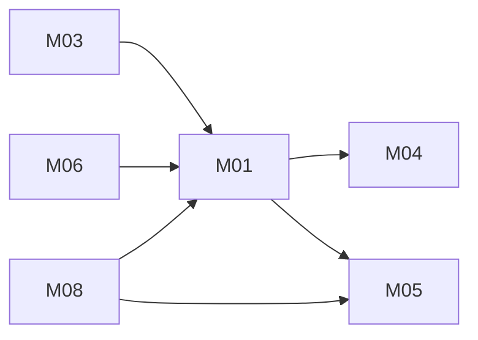

# Unified booking app: architecture

Version: 2026-11-04 · Status: approved (benchmark-operator, pre-approved in task) · Structured copy: `architecture.json`

## Architecture style

| Style | Fit | Why |
| --- | --- | --- |
| modular monolith | good (selected) | one team, one release, booking/payment/waitlist consistency in one transaction |
| microservices | poor | distributed saga for hold-charge-confirm, no scaling need |
| service-oriented | poor | no existing system to keep separate |
| event-driven | partial | only slot-freed is asynchronous; an in-process event covers it |
| hybrid | partial | broker not justified at this volume; revisit with calendar sync |

Selected: modular monolith with one in-process event (`slot-freed`: bookings → waitlist), because of the consistency driver and team size (D13).

## Stack

| Layer | Choice | Why (decision id) |
| --- | --- | --- |
| Frontend | Django templates + htmx | no source UI; one codebase (D10) |
| Backend | Python 3.12, Django 5, Stripe Python SDK (test mode) | A is Python; Django gives auth, sessions, CSRF, admin, migrations (D10) |
| Database | PostgreSQL 16 | transactions, partial unique index (D11, D06) |
| Jobs | scheduled management command every minute | offer expiry (D12) |
| Hosting | managed Python host + managed PostgreSQL, user's choice | no constraint given; no deployment (D13) |

## Modules

| Module | Responsibility | Features | Depends on | Owns entities |
| --- | --- | --- | --- | --- |
| accounts | sign-up, sign-in, sessions, roles, `can(user, action, record)` | - | - | User |
| slots | publish and list slots | M05 | accounts | Slot |
| payments | Stripe charges, refunds, webhook | M04 | accounts | Payment |
| bookings | hold-charge-confirm, 24h cancel, emits slot-freed | M01, M03 | accounts, slots, payments | Booking |
| recurring | weekly series 2-12, all-or-nothing | M06 | bookings, slots | BookingSeries |
| waitlist | join/leave, offers with hold, accept | M08 | bookings, slots, accounts | WaitlistEntry |

### Feature dependency map

## Data model

| Entity | Merged from | Primary key | Key fields | Notes |
| --- | --- | --- | --- | --- |
| User | new | uuid | email (citext, unique), password_hash, role (customer, staff) | neither source has accounts |
| Slot | A:Slot, B:Slot | uuid | starts_at, ends_at (timestamptz), price_amount (int minor units, from A price), currency, status (draft, published, withdrawn), published_by → User | A's `taken` derived from bookings (D09) |
| Booking | A:Booking, B:Booking | uuid | user_id → User, slot_id → Slot, status (held, confirmed, cancelled), series_id → BookingSeries, created_at, cancelled_at | partial unique index (slot_id) where status in (held, confirmed) (D06) |
| BookingSeries | new | uuid | user_id, weeks (2-12 check), status | B rule max 12 |
| Payment | new | uuid | booking_id → Booking, amount, currency, stripe_payment_intent_id, idempotency_key (unique), status, stripe_refund_id | A's payments.py missing |
| WaitlistEntry | B:WaitlistEntry | uuid | slot_id, user_id (unique together while waiting/offered), status, offer_expires_at | one offer per slot at a time |

Foreign keys are indexed; on delete: Booking → Slot restrict, Booking → User restrict, Payment → Booking restrict, WaitlistEntry → Slot cascade. Full DDL in `schema.sql`.

Migrations from source data: none can run now (no BookNow data provided; Slotty is closed). If BookNow data is supplied, `migration-plan.md` covers the high-risk steps (id re-keying, price conversion, dropping `taken`), approved as plans only (A03, A04).

## Authentication and authorization

One identity system: Django auth with email and password; server-side sessions in http-only, secure, SameSite=Lax cookies; CSRF on every POST (D07). One check, `accounts.can(user, action, record)`, is called by every view and every queryset filter: customers see and change only their own bookings, series and waitlist entries; staff manage slots.

| Source role | Unified role | Extra permissions |
| --- | --- | --- |
| A: none (user_id passed in) | customer | - |
| B: customer (documented audience) | customer | - |
| B: team publishing slots (documented audience) | staff | manage slots, view bookings on their slots |

## API

REST under `/api/v1`; error shape `{"error": {"code": "...", "message": "..."}}`; cursor pagination (`?cursor=`); session auth on every endpoint except sign-up, sign-in, the public slot list and the Stripe webhook (signature-verified) (D14). Full contracts in `api.md`.

| Method | Path | Module | Auth | Features |
| --- | --- | --- | --- | --- |
| POST | /api/v1/auth/signup | accounts | none | - |
| POST | /api/v1/auth/login | accounts | none | - |
| POST | /api/v1/auth/logout | accounts | session | - |
| GET | /api/v1/slots | slots | none | M05 |
| POST | /api/v1/slots | slots | staff | M05 |
| PATCH | /api/v1/slots/{id} | slots | staff | M05 |
| POST | /api/v1/bookings | bookings | session | M01, M04 |
| GET | /api/v1/bookings | bookings | session (own) | M01 |
| POST | /api/v1/bookings/{id}/cancel | bookings | owner | M03, M04 |
| POST | /api/v1/payments/stripe-webhook | payments | Stripe signature | M04 |
| POST | /api/v1/series | recurring | session | M06 |
| POST | /api/v1/series/{id}/cancel | recurring | owner | M06 |
| POST | /api/v1/slots/{id}/waitlist | waitlist | session | M08 |
| DELETE | /api/v1/waitlist/{id} | waitlist | owner | M08 |
| POST | /api/v1/waitlist/{id}/accept | waitlist | owner | M08 |

## Navigation

| Route | Screen | Module |
| --- | --- | --- |
| / | Open slots | slots |
| /signup | Sign up | accounts |
| /login | Sign in | accounts |
| /slots/{id} | Slot detail: book, book weekly, join waiting list | bookings |
| /bookings | My bookings and series | bookings |
| /waitlist | My waiting lists and offers | waitlist |
| /staff/slots | Manage slots | slots |
| /staff/slots/new | New slot | slots |

## Design system

Tokens: colour roles background, surface, text, muted, primary, danger, success, focus (contrast checked to WCAG AA); type scale 1.25 from 16px; spacing 4/8/12/16/24/32; radius 6px. Components: Button (primary, secondary, danger), SlotCard (open, taken, past), StatusBadge (held, confirmed, cancelled, waiting, offered), Form (default, error), Alert (info, error, success), EmptyState. Inter (OFL) and Lucide icons (ISC). The user's own brand; nothing visual from Slotty.

## Configuration

All read in one `config` module from environment variables; `.env.example` lists names only. Secrets: `DATABASE_URL`, `SECRET_KEY`, `STRIPE_SECRET_KEY`, `STRIPE_WEBHOOK_SECRET` (host's secret store, never in code or logs). Settings: `DEFAULT_CURRENCY` (dev default usd; source currency unknown), `CANCELLATION_WINDOW_HOURS` (24), `RECURRENCE_MAX_WEEKS` (12), `WAITLIST_OFFER_HOLD_MINUTES` (120), `ALLOWED_HOSTS`.

## Error handling

One error shape (D14). Domain errors: `slot_taken` (409), `too_late_to_cancel` (403), `payment_failed` (402), `series_weeks_taken` (409, lists weeks), `forbidden` (403), `not_found` (404), `validation` (422). Stripe calls use idempotency keys and retry on network errors with backoff up to 3 times; a failed charge releases the hold in the same request. Logs carry ids, never emails, card data or secrets.

## Roadmap

| Slice | Features | Done when | Status |
| --- | --- | --- | --- |
| V1 | M05, M04, M01 | AC01-AC05 pass | pending |
| V2 | M03 | AC06-AC07 pass | pending |
| V3 | M06 | AC08-AC09 pass | pending |
| V4 | M08 | AC10-AC11 pass | pending |

Not built in this run (plan mode).

## Decisions

| Id | Decision | Reason | Approved |
| --- | --- | --- | --- |
| D01 | Series charged up front per occurrence, all-or-nothing | keeps pay-at-booking | yes (operator) |
| D02 | Full refund on allowed cancel; soft cancel | no money lost on allowed cancel | yes (operator) |
| D03 | Waitlist offers, 2h hold, no auto-charge | release rule undocumented | yes (operator) |
| D04 | 24h rule per occurrence | consistent with A | yes (operator) |
| D05 | Series all-or-nothing | predictable payment | yes (operator) |
| D06 | Partial unique index + hold-charge-confirm | A never sets taken | yes (operator) |
| D07 | Email/password, sessions, customer and staff | no source auth | yes (operator) |
| D08 | One Booking entity | duplicate entity | yes (operator) |
| D09 | One Slot entity, taken derived | duplicate entity | yes (operator) |
| D10 | Python + Django + htmx | A is Python; built-ins | yes (operator) |
| D11 | PostgreSQL 16 | constraints | yes (operator) |
| D12 | Scheduled command for offer expiry | no broker needed | yes (operator) |
| D13 | Modular monolith + slot-freed event | consistency, team size | yes (operator) |
| D14 | REST /api/v1, one error shape, cursor pagination | one API style | yes (operator) |
| D15 | Calendar sync deferred | low confidence | yes (operator) |
