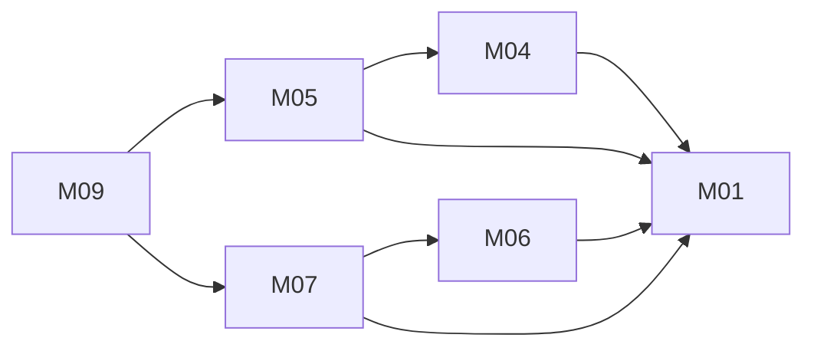

# Unified online shop: architecture

Version: 2026-11-04 · Status: approved (benchmark-operator, pre-approved in task) · Structured copy: `architecture.json`

## Architecture style

| Style | Fit | Why |
| --- | --- | --- |
| modular monolith | good (selected) | one small team, one release cadence, cart/order/review eligibility need one consistent database |
| microservices | poor | network calls and distributed data with no independent scaling need |
| service-oriented | poor | would keep the two source runtimes apart, which the merge removes |
| event-driven | partial | only the Stripe payment confirmation is asynchronous; one webhook handler covers it |
| hybrid | partial | no part clearly needs a second style yet |

Selected: modular monolith, because of one team, strong consistency and modest scale.

## Stack

| Layer | Choice | Why (decision id) |
| --- | --- | --- |
| Frontend | server-rendered Jinja2 + a little vanilla JS | no source has a frontend; fewest moving parts (D03) |
| Backend | Python 3.12, Flask 3.0, SQLAlchemy 2.0 | catalog adapted from PyShop; Stripe has an official Python SDK; one runtime (D01) |
| Database | PostgreSQL (SQLite in dev/tests) | one consistent relational store, integer keys (D02) |
| Payments | Stripe Checkout, test mode | kept from NodeCart, rebuilt safely (D04) |
| Hosting | not decided | user to choose |

NodeCart's Express/Prisma code is not reused (rebuilt as `improve`); Reviewly is rebuilt from its public docs only.

## Modules

| Module | Responsibility | Features | Depends on | Owns entities |
| --- | --- | --- | --- | --- |
| accounts | sign-up, sign-in, sessions, roles, `can(user, action, record)` | platform (no menu row) | - | User |
| catalog | products and prices | M01 | - | Product |
| cart | the signed-in customer's cart | M04 | accounts, catalog | Cart, CartItem |
| checkout | orders, Stripe sessions, webhook | M05 | accounts, catalog, cart | Order, OrderItem |
| reviews | list, write, verified-purchase gate | M06, M07, M09 | accounts, catalog, checkout | Review |

### Feature dependency map

## Data model

| Entity | Merged from | Primary key | Key fields | Notes |
| --- | --- | --- | --- | --- |
| User | new | id integer | email (unique), password_hash, role (customer/owner), created_at | no source had users |
| Product | A:Product | id integer (A's ids kept) | name, price_minor integer, currency, created_at | price was Numeric in A |
| Cart | B:Cart | id integer | user_id → User (unique, on delete cascade), created_at | B's uuid ids dropped |
| CartItem | B:CartItem | id integer | cart_id → Cart (cascade), product_id → Product (restrict), quantity integer CHECK >= 1, UNIQUE(cart_id, product_id) | B stored quantity as text |
| Order | new | id integer | user_id → User (restrict), status CHECK in (pending, paid, cancelled), total_minor, currency, stripe_session_id (unique), created_at, paid_at | written at checkout |
| OrderItem | new | id integer | order_id → Order (cascade), product_id → Product (restrict), quantity, unit_price_minor | price copied at checkout |
| Review | new (modelled on C's docs) | id integer | product_id → Product (cascade), user_id → User (cascade), rating CHECK 1..5, comment, created_at, UNIQUE(user_id, product_id) | no Reviewly data imported |

Indexes on every foreign key and on Review(product_id, created_at). Timestamps in UTC. Full DDL in `schema.sql`.

Migrations from source data (`migration-plan.md`, approved as a plan only, not run): A's products copied with ids kept and price converted to integer minor units (high risk: refused if any price has more than 2 decimals); B's carts and cart items discarded (high risk: transient data lost); A's carts out of scope; no Reviewly data.

## Authentication and authorization

One identity system (new): email + password, argon2id hash, server-side session id in an http-only, secure, SameSite=Lax cookie, CSRF token on form posts. Roles: customer, owner. Permissions: customer → cart:own, checkout:own, review:write-if-purchased; owner → catalog:manage. One function `can(user, action, record)` is called by every route and repository query.

| Source role | Unified role | Extra permissions |
| --- | --- | --- |
| A: none (Cart.user_id only) | customer | - |
| B: none (Cart.userId only) | customer | - |
| C: customer (documented) | customer | review:write-if-purchased |
| C: shop (documented, replies deferred) | owner | catalog:manage |

## API

REST, JSON, unversioned under `/api` (D07). Errors: `{"error": {"code", "message"}}` with 400/401/403/404/409. Lists paginate with `page` and `limit` (max 50). Auth: session cookie for every non-public endpoint; the Stripe webhook is authenticated by its signature. Full contracts in `api.md`.

| Method | Path | Module | Auth | Features |
| --- | --- | --- | --- | --- |
| POST | /api/auth/signup | accounts | none | platform |
| POST | /api/auth/login | accounts | none | platform |
| POST | /api/auth/logout | accounts | session | platform |
| GET | /api/products | catalog | none | M01 |
| GET | /api/products/{id} | catalog | none | M01 |
| GET | /api/cart | cart | session | M04 |
| POST | /api/cart/items | cart | session | M04 |
| POST | /api/checkout | checkout | session | M05 |
| POST | /api/stripe/webhook | checkout | Stripe signature | M05 |
| GET | /api/products/{id}/reviews | reviews | none | M06 |
| POST | /api/products/{id}/reviews | reviews | session | M07, M09 |

## Navigation

| Route | Screen | Module |
| --- | --- | --- |
| / | Product list | catalog |
| /products/{id} | Product page with reviews and review form | catalog |
| /cart | Cart | cart |
| /checkout/success | Order confirmation | checkout |
| /login | Sign in / sign up | accounts |

## Design system

Tokens: colour roles surface, text, muted, primary, danger (contrast checked to WCAG AA), 4px spacing scale, 1.25 type scale, 6px radius. Components: Button (primary, secondary), ProductCard, QuantityInput, StarRating (display, input), FormField, Alert. System font stack; no icon set needed. Nothing visual comes from Reviewly.

## Configuration

| Variable | Purpose | Default (dev) |
| --- | --- | --- |
| DATABASE_URL | database connection | sqlite:///dev.db |
| SECRET_KEY | session signing | none; required |
| STRIPE_SECRET | Stripe secret key, test mode | none; required for checkout |
| STRIPE_WEBHOOK_SECRET | webhook signature check | none; required for checkout |
| APP_BASE_URL | Stripe success/cancel URLs | http://localhost:5000 |

Read in one `config.py`; `.env.example` lists names only; secrets never in code or logs.

## Error handling

One error handler returns the error shape above; validation errors name the field. Logs hold request id, route and status, never emails, passwords, card data or keys. Stripe calls retry idempotently (idempotency key per Order); webhook handling is idempotent on stripe_session_id.

## Roadmap

| Slice | Features | Done when | Status |
| --- | --- | --- | --- |
| V1 | M01, M04 (+ accounts) | a signed-in customer browses products and builds a cart; AC01-AC03 pass | pending |
| V2 | M05 | checkout creates a pending Order from server prices and the verified webhook marks it paid; AC04-AC05 pass | pending |
| V3 | M06, M07, M09 | buyers with a paid order review the product and everyone can read it; AC06-AC08 pass | pending |

## Decisions

| Id | Decision | Reason | Approved |
| --- | --- | --- | --- |
| D01 | One Python/Flask/SQLAlchemy backend; NodeCart rebuilt in Python | catalog and durable data in PyShop; official Stripe Python SDK; one runtime | yes |
| D02 | PostgreSQL, integer keys | keeps A's product ids; B's uuids belonged to transient carts | yes |
| D03 | Server-rendered pages | no source frontend | yes |
| D04 | Stripe with server-built line items and verified webhook | fixes critical client-price flaw; gives the review gate a paid order | yes |
| D05 | New accounts module | no source has identity | yes |
| D06 | Migrate A's products; discard B's carts | carts transient, products durable | yes (plan only) |
| D07 | Unversioned REST, one error shape, page/limit | one API style | yes |
| D08 | Reviews without a paid order are refused (403) | Reviewly's rule undocumented; refusing is testable | yes |
