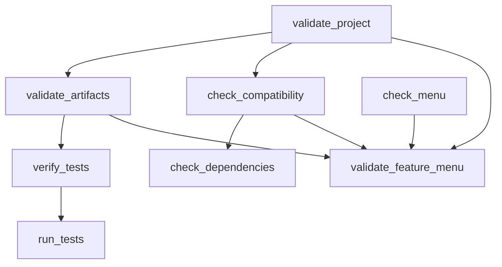

# How Feature Mixer is built

This describes the skill itself: its parts, how a run flows through them,
and the decisions behind them. For the architecture of the apps Feature Mixer
builds, see `feature-mixer/engines/architecture-design.md`.

## Principle

**Claude reasons; scripts check.** Understanding a codebase, judging which
features belong together, designing an architecture and writing code need
judgement, so Claude does them, guided by instruction files. Whether ids
resolve, dependencies are complete, conflicts are decided, evidence exists,
tests really ran and phases happened in order needs no judgement, so
deterministic scripts check it. A phase is done when its script says so.

## Layers

```
SKILL.md                     entry point: rules, inputs, workspace, phases, approvals, recovery
  engines/*.md               how each phase is done (read at the start of that phase)
    security.md              rules for every phase (the one home of the ground rules)
    reconnaissance.md        phase 1
    feature-intelligence.md  phases 2 and 3
    compatibility-analysis.md phase 4
    architecture-design.md   phase 5
    implementation.md        phases 6 and 8
    validation.md            phase 7, and the reference for every script
  scripts/*.py               deterministic tools (Python 3.8+, standard library, offline)
  schemas/*.json             the shape of every machine-readable file
  templates/*                starting points for every file a run writes
```

Only `SKILL.md`'s frontmatter is in Claude's context until the skill is
used. The engines load one at a time, so a run never carries every
instruction at once.

## Scripts

| script | reads | writes | role |
| --- | --- | --- | --- |
| `check_environment.py` | the system | `capabilities.json` | what the session can do |
| `scan_source.py` | a source folder | `security-scan.json` | risks before reading |
| `index_repo.py` | a source folder, `source.json` | `index.json` | inventory, modules, imports, feature-to-file map, changes |
| `checkpoint.py` | `mixer/`, the app folder | `checkpoints/CPn/`, `project.json` | snapshots and restore |
| `validate_feature_menu.py` (`check_menu.py`) | `feature-menu.csv` | the menu (with `--set`) | menu rules, selection view |
| `check_dependencies.py` | manifests, `source.json`, audits, indexes | stdout | stack conflicts, vulnerabilities, necessity |
| `check_compatibility.py` | every `source.json`, menu, aliases, manual conflicts, resolutions, architecture | `compat/compatibility-report.*` | conflicts and migrations |
| `run_tests.py` | the app's tests | `test-runs/<id>/`, integration report | execution evidence |
| `verify_tests.py` | integration report, test runs, PRD, baseline | `test-verification.json`, baseline | is the report true |
| `validate_artifacts.py` | everything in `mixer/` | stdout | file-level checks |
| `validate_project.py` | everything in `mixer/` | stdout | phase gates |
| `mixerlib.py` | | | shared constants, schema checker, graph cycles, reports |



Every script imports its siblings from its own folder, so it runs the same
from any working directory, inside the repository or copied to
`~/.claude/skills/`.

## A run

```
capabilities ─ scan ─ index ─ report      (per source)
     └────────────────────────────┬────── feature menu ─ selection ─ merge plan
                                  │                                     │
                     compatibility analysis ─ resolutions ─ architecture (style, schema, API, slices)
                                                                        │
                                       build slice ─ run_tests ─ verify_tests ─ next slice
                                                                        │
                                                integration report ─ verified features ─ (deployment if asked)
```

State lives in files, not in the conversation: `project.json` (phases,
approvals, checkpoints) and `mixer-log.md` (decisions). A run that stops can
resume from them.

## Trust model

| claim | accepted when |
| --- | --- |
| "the source does X" | evidence with a locator and a basis; confidence no higher than the basis allows; the session had the capability the input needed |
| "coverage is complete" | every indexed module analysed or skipped with a reason; no stale features |
| "these features merge" | the menu's merge type allows it; the merge plan puts them in one unified feature |
| "no blocking conflicts" | every critical conflict resolved and every high one decided with recorded approval |
| "the feature works" | a test tagged with it passed in a run recorded by `run_tests.py`, and `verify_tests.py` matched the report to that run |
| "the user approved" | an entry in `project.json` (`phases.*.approved` or `approvals`) |

## Workspace formats

`project.json` `"format"` selects strictness:

- `2`: a 2.0 workspace. 2.1 checks are warnings, legacy test reports still
  count (marked unverified).
- `3`: a 2.1 workspace. 2.1 checks are errors; only verified test results
  prove anything.

Credentials in `mixer/` are an error in both.

## Design decisions

- **One skill, many instruction files.** Phases need different guidance;
  loading it per phase keeps context small. Engines are not separate
  skills, so nothing else must be installed.
- **Standard library only.** The validators run anywhere Python 3.8 runs,
  with nothing to install and nothing to audit.
- **Offline scripts.** No script touches the network. Anything that needs it
  (audits, cloning) is a separate, approved step whose output the scripts
  then read.
- **Additive schema changes.** 2.1 adds fields and values; it removes
  nothing, so 2.0 workspaces keep validating.
- **Evidence over trust.** The validators cannot read code, but they can make
  every claim traceable and refuse claims without a trace.
