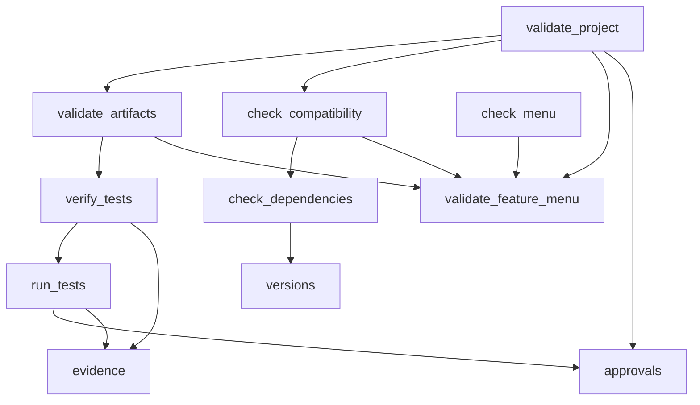

# How Feature Mixer is built

This describes the skill itself: its parts, how a run flows through them,
and the decisions behind them. For the architecture of the apps Feature Mixer
builds, see `feature-mixer/engines/architecture-design.md`.

## Principle

**Claude reasons; scripts check.** Understanding a codebase, judging which
features belong together, designing an architecture and writing code need
judgement, so Claude does them, guided by instruction files. Whether ids
resolve, dependencies are complete, conflicts are decided, evidence exists,
tests really ran and phases happened in order needs no judgement, so
deterministic scripts check it. A phase is done when its script says so.

## Layers

```
SKILL.md                     entry point: rules, inputs, workspace, phases, approvals, recovery
  engines/*.md               how each phase is done (read at the start of that phase)
    security.md              rules for every phase (the one home of the ground rules)
    reconnaissance.md        phase 1
    feature-intelligence.md  phases 2 and 3
    compatibility-analysis.md phase 4
    architecture-design.md   phase 5
    implementation.md        phases 6 and 8
    validation.md            phase 7, and the reference for every script
  scripts/*.py               deterministic tools (Python 3.8+, standard library, offline)
  schemas/*.json             the shape of every machine-readable file
  templates/*                starting points for every file a run writes
```

Only `SKILL.md`'s frontmatter is in Claude's context until the skill is
used. The engines load one at a time, so a run never carries every
instruction at once.

## Scripts

| script | reads | writes | role |
| --- | --- | --- | --- |
| `check_environment.py` | the system | `capabilities.json` | what the session can do |
| `scan_source.py` | a source folder | `security-scan.json` | risks before reading |
| `index_repo.py` | a source folder, `source.json` | `index.json` | inventory, modules, imports, feature-to-file map, changes |
| `checkpoint.py` | `mixer/`, the app folder | `checkpoints/CPn/`, `project.json` | snapshots and restore |
| `validate_feature_menu.py` (`check_menu.py`) | `feature-menu.csv` | the menu (with `--set`) | menu rules, selection view |
| `check_dependencies.py` | manifests, `source.json`, audits, indexes | stdout | stack conflicts, vulnerabilities, necessity |
| `check_compatibility.py` | every `source.json`, menu, aliases, manual conflicts, resolutions, architecture | `compat/compatibility-report.*` | conflicts and migrations |
| `approvals.py` | `project.json`, the folder to run in | `project.json` approvals and phase approvals, `approval-log.jsonl` | scoped approvals and the check that enforces them; phase fingerprints |
| `run_tests.py` | the app's tests | `test-runs/<id>/`, `test-runs/ledger.jsonl`, integration report | authorised, time-limited execution; evidence and a verdict |
| `verify_tests.py` | integration report, test runs, ledger, the tested code, PRD, baseline, resolutions | `test-verification.json`, baseline | is the report true, and does it still describe the code |
| `evidence.py` | | | fingerprints, the hash-chained ledger, HMAC signing, the run lock, atomic writes |
| `versions.py` | | | version-range arithmetic for npm, Cargo, Poetry and PEP 440 |
| `validate_artifacts.py` | everything in `mixer/` | stdout | file-level checks |
| `validate_project.py` | everything in `mixer/` | stdout | phase gates |
| `mixerlib.py` | | | shared constants, schema checker, graph cycles, reports |



Every script imports its siblings from its own folder, so it runs the same
from any working directory, inside the repository or copied to
`~/.claude/skills/`.

## A run

```
capabilities ─ scan ─ index ─ report      (per source)
     └────────────────────────────┬────── feature menu ─ selection ─ merge plan
                                  │                                     │
                     compatibility analysis ─ resolutions ─ architecture (style, schema, API, slices)
                                                                        │
                         approvals.py grant ─ build slice ─ run_tests ─ verify_tests ─ next slice
                                                                        │
                                                integration report ─ verified features ─ (deployment if asked)
```

State lives in files, not in the conversation: `project.json` (phases,
approvals, checkpoints) and `mixer-log.md` (decisions). A run that stops can
resume from them.

## Trust model

| claim | accepted when |
| --- | --- |
| "the source does X" | evidence with a locator and a basis; confidence no higher than the basis allows; the session had the capability the input needed |
| "coverage is complete" | every indexed module analysed or skipped with a reason; no stale features |
| "these features merge" | the menu's merge type allows it; the merge plan puts them in one unified feature |
| "no blocking conflicts" | every critical conflict resolved and every high one decided with recorded approval |
| "the feature works" | a test tagged with it passed in a run recorded by `run_tests.py` whose verdict is `passed` or `failed` (not `no-tests`, `timed-out`, `inconsistent`...), the run is in an intact ledger, the code has not changed since, and `verify_tests.py` matched the report to that run |
| "this may run" | an approval in `project.json` scoped to this action, folder and exact command, unexpired, unrevoked, not used up (`approvals.py`); `run_tests.py` checks it before executing anything |
| "the user approved" | an entry in `project.json` (`phases.*.approved` with `approved_fingerprint`, or `approvals`); it is a record the workspace holds, not proof a human agreed (see SECURITY.md) |
| "the decision still stands" | the fingerprint of the approved files still matches; otherwise the phase changed after approval |

## Workspace formats

`project.json` `"format"` selects strictness:

- `2`: a 2.0 workspace. 2.1 checks are warnings, legacy test reports still
  count (marked unverified).
- `3`: a 2.1 workspace. 2.1 checks are errors; only verified test results
  prove anything.
- `4`: a 2.2 workspace. 2.2 checks are errors too: recorded phase approvals
  and no change since, a passing journey test, observed vs documented
  honesty, a ledger and a code fingerprint for every run.

Two things apply in every format because they are about running code now:
`run_tests.py` needs a scoped approval, and a run recorded by the 2.2 runner
is held to the 2.2 evidence rules. Credentials in `mixer/` are an error in all
formats.

## Defences in depth (2.2)

| layer | what it stops | what it does not stop |
| --- | --- | --- |
| scoped approvals | running anything other than the approved command in the approved folder; reuse after expiry or code change | an agent that writes its own approval record (a rule, not a lock) |
| process group, timeout | hung suites, forked daemons, output floods | processes that leave the group (`setsid`) |
| verdicts | zero tests, all skipped, exit code vs results, stale, malformed or self-contradicting results | tests that pass trivially |
| ledger, read-only files, report and code fingerprints | editing evidence, reusing another run's or another workspace's evidence, evidence for code that has since changed | a consistent rewrite of everything, without a key or an external copy |
| HMAC key outside `mixer/`, external copy | that consistent rewrite | a writer who can read the key or reach the copy |
| `--rerun` under approval | evidence that does not describe the code's real behaviour | nothing that a fresh run in isolation would not show |

## Design decisions

- **One skill, many instruction files.** Phases need different guidance;
  loading it per phase keeps context small. Engines are not separate
  skills, so nothing else must be installed.
- **Standard library only.** The validators run anywhere Python 3.8 runs,
  with nothing to install and nothing to audit.
- **Offline scripts.** No script touches the network. Anything that needs it
  (audits, cloning) is a separate, approved step whose output the scripts
  then read.
- **Additive schema changes.** 2.1 and 2.2 add fields and values; they
  remove nothing, so 2.0 and 2.1 workspaces keep validating.
- **Probe first, then fix.** Every 2.2 fix began as a probe that succeeded
  against 2.1.0 (`benchmarks/probes/run_probes.py`); the same probes now
  gate releases (`release_check.py --probes`).
- **Evidence over trust.** The validators cannot read code, but they can make
  every claim traceable and refuse claims without a trace.
