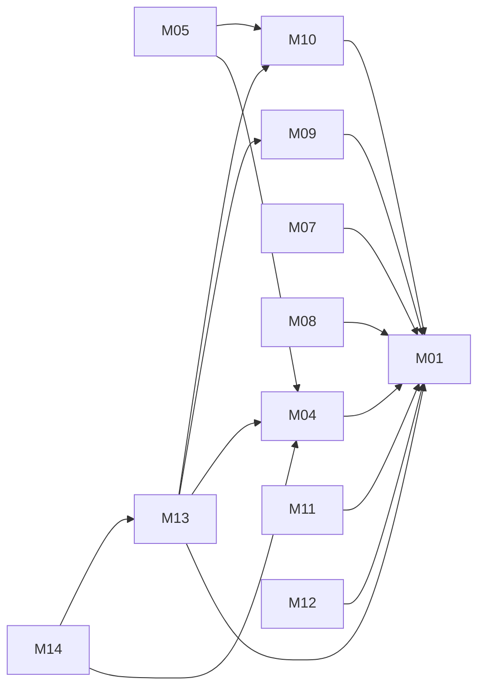

# Team Hub: architecture

Version: 2026-11-04 · Status: approved · Structured copy: `architecture.json`

## Stack

| Layer | Choice | Why (decision id) |
| --- | --- | --- |
| Backend | Python 3.8+, standard library `http.server` | D01: runs with nothing to install |
| Database | SQLite, foreign keys on | D01 |
| Auth | Own accounts, PBKDF2, http-only cookie sessions | D02 |
| Frontend | None in this example (API only) | PRD out of scope |

Sources A and B are Node and React. Their code could legally be reused (own
code and MIT), but D01 picks a different stack for the example, so every
kept feature is rebuilt or combined rather than adapted. Pulse (C) is closed
and is rebuilt from its public docs only.

## Modules

| Module | Responsibility | Features | Depends on | Owns entities |
| --- | --- | --- | --- | --- |
| accounts | users, sign-in, sessions, roles, permission check | M01, M08, M09 | - | User, Session |
| notifications | one engine, three channels | M10, M11, M12 | accounts | Notification, Delivery, PushSubscription |
| tasks | board, status, assignment, status guards | M04, M05 | accounts, notifications | Task |
| approvals | requests on tasks, decisions | M13 | accounts, tasks, notifications | Approval |
| comments | threads on tasks and approvals | M07 | accounts, notifications | Comment |
| dashboard | workload | M14 | accounts, tasks, approvals | - |
| api | HTTP routes and errors | - | all of the above | - |

`tasks` must not depend on `approvals` (that would be a cycle). The rule
"no closing a task with a pending approval" is a status guard that
`approvals` registers with `tasks` at start-up.

### Feature dependency map

## Data model

| Entity | Merged from | Primary key | Key fields | Notes |
| --- | --- | --- | --- | --- |
| User | A:User, B:User | uuid | email, name, role, can_approve, notify_email, notify_push, legacy_id | B's full_name → name; B's ids → legacy_id (D03) |
| Session | new | token | user_id, last_seen | 30 minutes idle |
| Task | A:Task | uuid | title, status, assignee_id, created_by, due_on | |
| Approval | B:ApprovalRequest | uuid | task_id, requester_id, approver_id, status | now attached to a task |
| Comment | B:Comment | uuid | subject_type, subject_id, parent_id, author_id, body | tasks and approvals |
| Notification | A:Notification | uuid | user_id, event, message, dedupe_key, read_at | |
| Delivery | B:EmailOutbox | uuid | notification_id, channel, target, status | email and push |
| PushSubscription | C:PushSubscription | uuid | user_id, endpoint | https only |

Migrations from source data: importing B's users re-keys them to uuid and
rewrites B's foreign keys (approved as `migration:user`, dry run on a copy
first). The example starts from an empty database.

## Authentication and authorization

Email and password; PBKDF2 hashes; an http-only `session` cookie that ends
after 30 idle minutes. One function, `auth.can(user, permission)`, answers
every permission question.

| Source role | Unified role | Extra permissions |
| --- | --- | --- |
| A owner | owner | |
| A member | member | |
| B admin | admin | |
| B requester | member | |
| B approver | member | approve |
| C admin | admin | |
| C member | member | |

## API

JSON over HTTP, unversioned `/api` (D05), errors as
`{"error": {"code", "message"}}`, PATCH for partial updates, the session
cookie on every endpoint except sign-in. The full list is in
`architecture.json` → `api`.

## Navigation

No screens in this example. A UI would have one `/login` and one
`/settings` (the route collisions resolved in the compatibility phase).

## Design system

Not applicable to the API-only example; see `architecture.json` →
`design_system`.

## Configuration

Environment variables read once in `teamhub/config.py` (D07):
`TEAMHUB_DB`, `TEAMHUB_SESSION_IDLE_MINUTES`, `TEAMHUB_PASSWORD_ITERATIONS`,
`TEAMHUB_HOST`, `TEAMHUB_PORT`, `TEAMHUB_SECURE_COOKIE`. No secrets are
needed yet.

## Error handling

Every module raises one of `Invalid` (400), `Unauthorized` (401),
`Forbidden` (403), `NotFound` (404), `MethodNotAllowed` (405) or `Conflict`
(409); the API turns them into the error format. Anything unexpected is a
500 with no details. No request logging.

## Roadmap

| Slice | Features | Done when | Status |
| --- | --- | --- | --- |
| V1 | M01, M08, M09, M04, M05 | sign in, roles, create, move and assign tasks pass their tests | done |
| V2 | M10, M11, M12 | one notification per event on every chosen channel | done |
| V3 | M13, M07 | approval journey and threaded comments pass | done |
| V4 | M14 | dashboard counts pass | done |

## Decisions

| Id | Decision | Reason | Approved |
| --- | --- | --- | --- |
| D01 | Python standard library and SQLite | runs with nothing to install | yes |
| D02 | Cookie sessions, 30 minutes idle | session and endpoint-auth conflicts | yes |
| D03 | uuid keys; legacy_id for B | critical primary key conflict | yes |
| D04 | owner, admin, member plus approve | role conflict | yes |
| D05 | One unversioned /api, one user shape | contract and version conflicts | yes |
| D06 | UTC everywhere; overdue by UTC date | Pulse's rule is unknown | yes |
| D07 | Settings from environment variables | one configuration strategy | yes |
