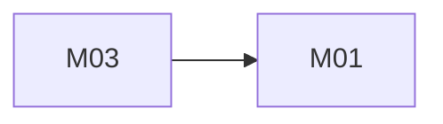

# <Product name>: architecture

Version: <date> · Status: draft | approved · Structured copy: `architecture.json`

## Architecture style

| Style | Fit | Why |
| --- | --- | --- |
| modular monolith | | |
| microservices | | |
| service-oriented | | |
| event-driven | | |
| hybrid | | |

Selected: <style>, because <drivers>.

## Stack

| Layer | Choice | Why (decision id) |
| --- | --- | --- |
| Frontend | | |
| Backend | | |
| Database | | |
| Hosting | | |

## Modules

| Module | Responsibility | Features | Depends on | Owns entities |
| --- | --- | --- | --- | --- |

### Feature dependency map

## Data model

| Entity | Merged from | Primary key | Key fields | Notes |
| --- | --- | --- | --- | --- |

Migrations from source data: <what moves, how, which steps are destructive
and their approval>.

## Authentication and authorization

Identity system, sign-in methods, session mechanism, roles, permissions,
and the role mapping from every source role.

| Source role | Unified role | Extra permissions |
| --- | --- | --- |

## API

Style, versioning, error format, pagination, auth. Then every endpoint:

| Method | Path | Module | Auth | Features |
| --- | --- | --- | --- | --- |

## Navigation

| Route | Screen | Module |
| --- | --- | --- |

## Design system

Tokens (colour roles, type scale, spacing, radius), the component list with
variants, and the open fonts and icon set used.

## Configuration

Every environment variable, its purpose and default. Where secrets live.

## Error handling

The error format, logging rules (no personal data), retries for external
services.

## Roadmap

| Slice | Features | Done when | Status |
| --- | --- | --- | --- |
| V1 | | | pending |

## Decisions

| Id | Decision | Reason | Approved |
| --- | --- | --- | --- |
| D01 | | | |
